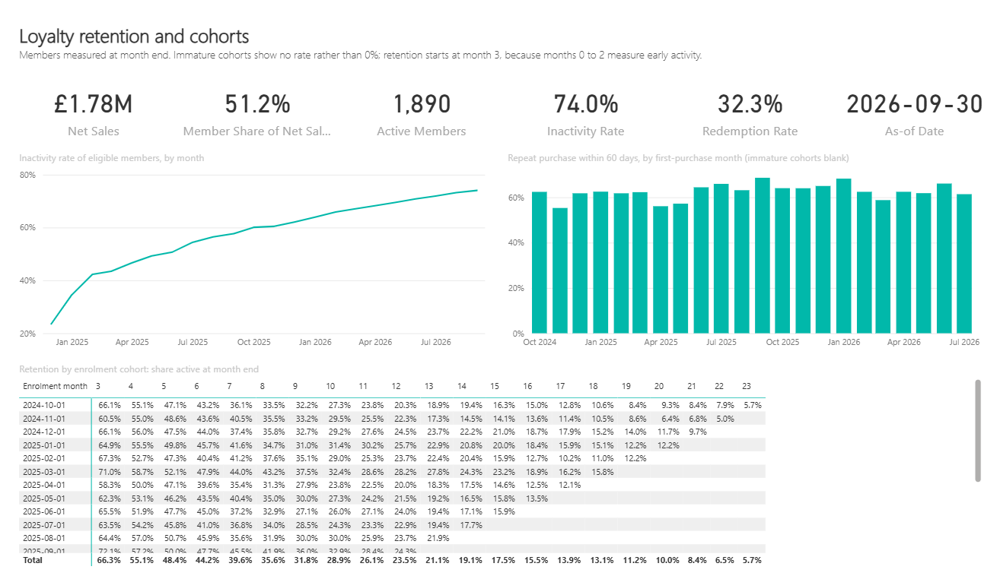
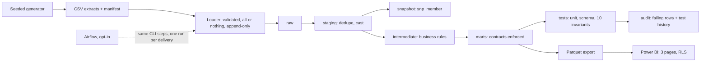
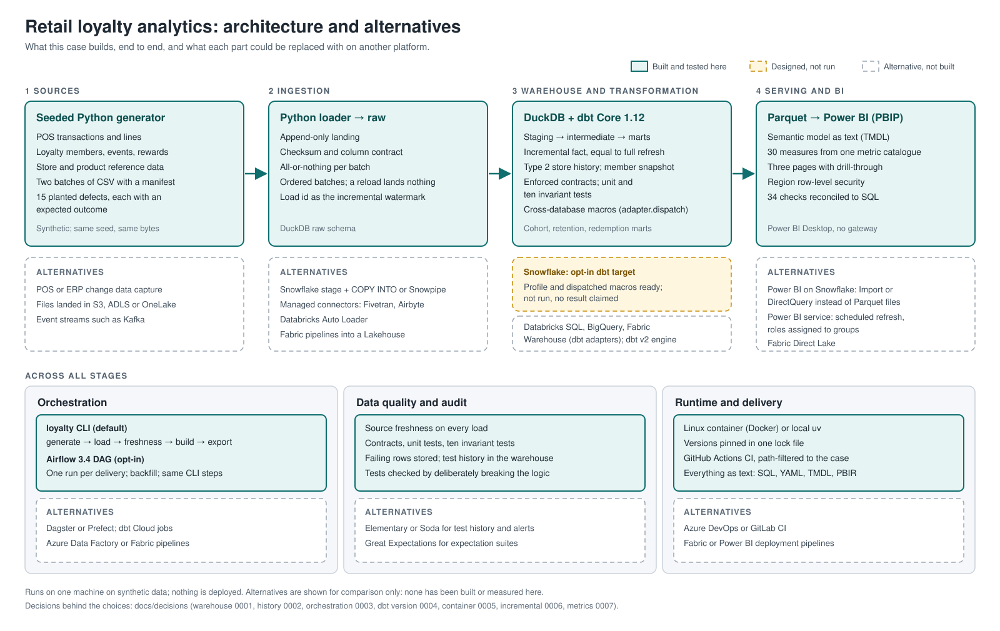

# Retail loyalty analytics

**Status: built and validated locally on synthetic data.** It runs end to end in a Linux container or with local Python, with no account or credentials. CI is written but its runs on GitHub have not yet been checked. Snowflake is an opt-in target that has not been run. Nothing is deployed.

A fictional retailer's marketing, store and finance teams count active members, repeat customers and redemptions differently. This case builds one warehouse whose definitions make those numbers agree, and keep agreeing when returns and corrections arrive late.

**Stack:** dbt Core on DuckDB, Python, SQL, Power BI (PBIP/TMDL); Docker for a Linux runtime; Airflow as opt-in orchestration. **Reading depth:** this page, then the [data model](docs/data-model.md) and [decisions](docs/decisions/README.md), then the code paths in section 6.



```powershell
docker compose run --rm loyalty run-all                    # generate, load and build both batches, export: under two minutes
docker compose run --rm --entrypoint pytest loyalty -q     # 58 tests
```

Without Docker: `uv sync`, then `uv run loyalty run-all` and `uv run pytest`. Every command is in the [runbook](docs/runbook.md).

## 1. Problem and decision

| Who | Decision | What they need |
| --- | --- | --- |
| Loyalty marketing | Which cohorts and members to re-engage | Repeat purchase and retention by cohort, with immature cohorts kept apart; inactive members, including those who never bought |
| Store operations | Which stores and rewards underperform | Sales per trading day, fair across stores that opened at different times; redemption rate with a defensible denominator |
| Finance | Whether reported sales can be trusted | Net sales after returns that reconcile to the till data, on either date basis |

## 2. Scope and success

**In scope:**
- **Sources:** two batches of synthetic extracts, landed append-only.
- **dbt layers:** staging, intermediate and marts.
- **History and loading:** an incremental fact, a type 2 store dimension, and a member snapshot.
- **Data quality:** source freshness, enforced contracts, unit and invariant tests, and a test-result history.
- **Delivery:** a Power BI report with RLS, an opt-in Airflow DAG, and CI.

**Out of scope:** campaign attribution, churn prediction, points accounting, personal data, multiple currencies, a live Snowflake or Power BI service deployment.

**Correct means:** all 15 planted defects reach their stated outcome; ten business invariants hold; an incremental build equals a full refresh after late data; and every report figure reconciles to independent SQL. All [15 acceptance criteria](docs/requirements.md#acceptance) link to their evidence.

## 3. Data

All synthetic, from a seeded Python generator: same seed, same bytes, on Windows and Linux alike. Two years of a 12-store retailer, delivered in two batches.

| | Batch 1 + batch 2 |
| --- | --- |
| Transactions | 53,487 + 1,291 rows |
| Transaction lines | 115,565 + 2,813 |
| Loyalty events | 53,815 + 1,225 |
| Reward entitlements | 14,474 + 391 |
| Members | 6,006, of whom about 18% never buy |

**Planted defects** ([full list](docs/data-model.md#planted-defects)):
- **Duplicates:** duplicate deliveries and duplicate events.
- **Returns:** late returns, a return with no sale, and an over-return.
- **Sales context:** anonymous sales, a store refit, and a product sold before master data had it.
- **Late corrections:** a member attached to a sale after the fact, and a corrected enrolment date.
- **Rewards:** a reward status column that disagrees with the event log.
- **Maturity:** members who enrolled days before the cut-off.

Each planted defect has an expected outcome that a test asserts. The rest of the data is clean by construction, and tests check that.

## 4. Architecture



What each part could be replaced with on another platform, Snowflake instead of DuckDB among them, is shown below. Only the solid boxes are built.



One CLI runs every step. It works in a Linux container, with the DuckDB file on a Docker volume, or with local Python. The opt-in Airflow DAG calls the same steps, one run per extract delivery. A production design would land extracts in object storage and load a cloud warehouse on arrival; that is not built ([architecture](docs/architecture.md)).

## 5. Modelling

Every model declares its grain ([data model](docs/data-model.md#mart-grain)). Money is `decimal(18,2)` in pounds, with no floating point anywhere.

- **Separate grains.** Sales lines carry the money. Transactions roll the lines up. Loyalty events carry points and never money, so joining them can never multiply revenue.
- **Returns are their own transactions,** linked to the sale line they return. One fact therefore serves two date bases: finance books a return on its own date; the cohort and product views move it back to the sale it undoes.
- **Two kinds of history** ([decision 0002](docs/decisions/0002-history-strategy.md)).
  - Store versions are rebuilt from the dated history in raw, so they are exact and reproducible.
  - Members are snapshotted, because the source overwrites corrections. The snapshot keeps what was reported before a correction.
- **Metrics follow [one catalogue](docs/metrics.md).** dbt computes the rules: qualifying purchase, 90-day activity, eligibility, cohort maturity, reward status. DAX only counts and divides ([decision 0007](docs/decisions/0007-metric-logic-dbt-and-dax.md)). An immature cohort's rate is blank, never 0%.

## 6. Implementation

| Path | Why read it |
| --- | --- |
| [fct_sales_line.sql](dbt/models/marts/fct_sales_line.sql) | The incremental boundary: reprocess by load, include dependants, repair late store versions, replace whole transactions ([decision 0006](docs/decisions/0006-incremental-boundary.md)) |
| [int_sales_lines_with_returns.sql](dbt/models/intermediate/int_sales_lines_with_returns.sql) | Linking returns to sales, two date bases, over-returns in time order |
| [fct_member_month.sql](dbt/models/marts/fct_member_month.sql) | A dense member-month snapshot with eligibility and 90-day activity |
| [int_entitlements_resolved.sql](dbt/models/intermediate/int_entitlements_resolved.sql) | Trusting the event log over a status column, and counting where they disagree |
| [dim_store.sql](dbt/models/marts/dim_store.sql) | Type 2 history from source versions, half-open validity |
| [dbt/tests](dbt/tests) | Ten business invariants, one file each |
| [loader.py](src/loyalty/loader.py) | Manifest and contract checks, all-or-nothing landing, ordered batches |
| [record_test_results.sql](dbt/macros/record_test_results.sql) | Every test result kept in the warehouse, by an `on-run-end` hook |
| [bi/RetailLoyalty.SemanticModel](bi/RetailLoyalty.SemanticModel/definition) | The Power BI model as text: relationships, 30 measures, RLS roles |
| [bi/reconcile.ps1](bi/reconcile.ps1) | Evaluates DAX in Power BI Desktop's engine against SQL |

## 7. Reliability

- **Tests:** 58 in pytest. Each `dbt build` runs 106 checks: schema tests, seven unit tests and ten singular invariant tests. Failing rows go to an `audit` schema, and every result is kept in `audit.dq_test_result`.
- **Rerun safety:** reloading a batch lands nothing. A rebuild with nothing new rewrites no row.
- **Late data:** an incremental build equals a full refresh after batch 2, after a late store version, and after a sale arriving after its return.
- **Injected failures:** each is tested.
  - A changed file, a changed column, or a failure part-way through a load leaves nothing behind.
  - A stale extract fails freshness.
  - A changed column type fails its enforced contract.
- **Mutation checks:** throwaway scripts broke the logic 35 ways. All were caught, one only after a unit test was added.
- **CI:** [a workflow](../../.github/workflows/case-02-ci.yml), path-filtered to this case. It lints, parses dbt with deprecations treated as errors, runs the pipeline from an empty warehouse, runs every test, builds both Docker images, and checks the Airflow DAG's shape. **Its runs on GitHub have not yet been checked.**

## 8. Business consumption

A [Power BI report](bi/README.md) whose model, measures and pages are all text in Git:
- **Retention and cohorts:** KPIs, inactivity by month, repeat purchase by cohort, and a retention matrix.
- **Stores and rewards:** one row per store version, sales per trading day, and redemption by reward type.
- **Store detail:** a drill-through page.

Two region roles demonstrate RLS. [Screenshots](evidence/screenshots/).

On this synthetic data:
- 74% of eligible members were inactive in September 2026.
- 61% of the July 2026 first-purchase cohort bought again within 60 days.
- 32% of resolved rewards were redeemed: 66% of points vouchers and 9% of birthday offers.

The member and non-member comparison is labelled descriptive, not causal.

## 9. Results

Measured on Windows 11 with Docker Desktop, seed 2602. Single runs; timings are indicative only. Full record: [run record](evidence/run-record.md).

| Check | Result |
| --- | --- |
| Planted defects reaching their expected outcome | 15 of 15 |
| `dbt build` per batch | 106 of 106 pass, no warnings |
| pytest | 58 passed |
| Incremental against full refresh | 0 differing rows, in all three late-data cases |
| Rows the batch 2 incremental run rewrote | 2,818 of 118,376 |
| Power BI measures against SQL | 34 of 34, including RLS allowed and denied |
| Airflow backfill against `run-all` | All 11 marts identical; a rerun changed nothing |
| Generator output, Windows against Linux | Byte-identical |

## 10. Trade-offs and next step

- **DuckDB, not Snowflake** ([0001](docs/decisions/0001-warehouse-target.md)). Anyone can run it, but warehouse-specific tuning is argued in prose, not shown. Models use dispatched macros where engines differ.
- **dbt Core v1, kept ready for v2** ([0004](docs/decisions/0004-dbt-core-v1.md)). CI fails on any deprecation.
- **Airflow is opt-in** ([0003](docs/decisions/0003-orchestration.md)). A linear pipeline does not need a scheduler to run; the DAG exists to show intervals and backfill.
- **A dense member-month table** grows with members × months. At scale it would become an incremental periodic snapshot.

**Known limitations:**
- **No real retailer.** No finance or marketing professional has reviewed the definitions.
- **Inactivity is high** because the generator's members stop buying after about ten months on average.
- **No delete markers.** The extracts never mark a deletion, so a deleted transaction needs a full refresh.
- **Power BI is Desktop only.** RLS, refresh and sharing in the Power BI service are not shown.
- **Snowflake is untested.** It is an opt-in target that has never been run.

**Next step:** confirm CI on GitHub, then run the Snowflake target once and record its cost.

## Documentation

[Requirements](docs/requirements.md) · [Data model](docs/data-model.md) · [Metrics](docs/metrics.md) · [Architecture](docs/architecture.md) · [Decisions](docs/decisions/README.md) · [Runbook](docs/runbook.md) · [Power BI](bi/README.md) · [Orchestration](orchestration/README.md) · [Evidence](evidence/README.md)

[Return to portfolio](../../README.md).
