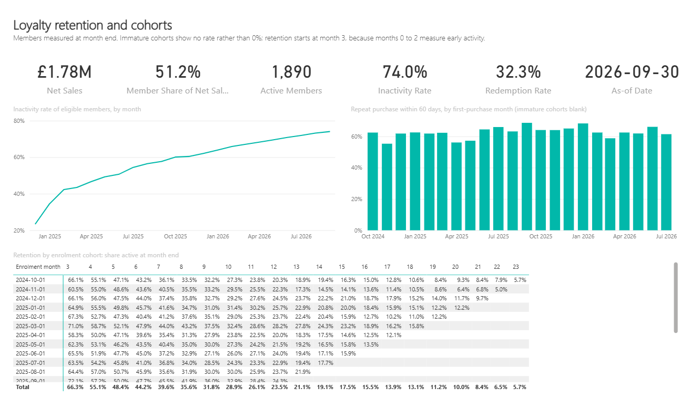
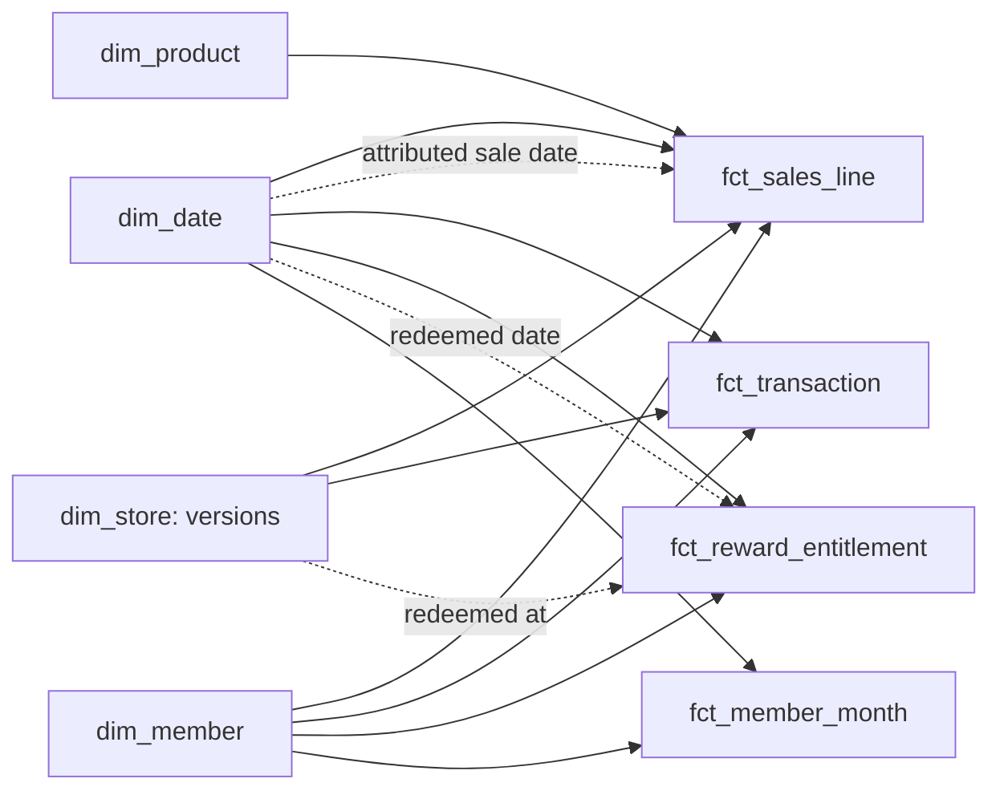

# Power BI

A Power BI Project (PBIP) whose semantic model is plain text (TMDL), so every table, relationship, measure and role is reviewable in Git. It reads the Parquet files written by `loyalty export`, with no gateway, driver or credential.

Status: **built and reconciled** with Power BI Desktop 2.158, 11–12 November 2026: semantic model, three report pages, region RLS ([evidence](../evidence/power-bi-reconciliation.md)).

## Report

| Page | For | Shows |
| --- | --- | --- |
| [Retention and cohorts](../evidence/screenshots/report-executive.png) | Loyalty marketing, executives | Net sales, member share, active members, inactivity rate, redemption rate, as-of date; inactivity by month; repeat purchase by first-purchase cohort (immature cohorts left blank); retention matrix by enrolment cohort from month 3 |
| [Stores and rewards](../evidence/screenshots/report-stores.png) | Store operations | Region filter; net sales per trading day, basket, returns, status conflicts, failed tests in the last build; one row per store version; redemption rate by reward type; net sales on both date bases |
| [Store detail](../evidence/screenshots/report-store-detail.png) | Store operations, by drill-through | One store's sales by month and category, and its versions. The screenshot shows Store 003 before and after its refit on 1 September 2025 |



The pages are PBIR files written as text. Each was opened in Power BI Desktop, refreshed, and checked from a screenshot. Looking at them found two things the reconciliation could not:
- a "(Blank)" region in the slicer. The store-to-redemption relationship is now applied in `[Redemptions]` with `TREATAS` instead;
- an empty column total in the cohort matrix, now switched off.

## Model



Dotted lines are inactive relationships, used only through `USERELATIONSHIP` in the measure that needs them. Redemptions reach stores through `TREATAS` in `[Redemptions]`, not a relationship. The cohort aggregates and the test history stand alone.

| Decision | Why |
| --- | --- |
| Facts relate to the **store version** in force on their date | A region or format change re-labels later sales, not earlier ones. Filtering on "North" shows S007's sales only from 1 January 2026 |
| Two date roles for sales | `[Net Sales]` on the transaction date (finance); `[Net Sales (attributed to sale date)]` moves returns back to their sale |
| **No** store → entitlement relationship | Only redeemed entitlements have a store. An active relationship would hide every unredeemed reward under a store filter or an RLS role and inflate the redemption rate. Even an inactive one adds a "(Blank)" store to every store list. `[Redemptions]` applies the store filter with `TREATAS` |
| Member counts are **snapshots** | `[Eligible Members]`, `[Inactive Members]` and `[Active Members]` take the last month in the filter, so a year shows September's members, not the sum of twelve months |
| Rules live in dbt, aggregation in DAX | Each rule is written once and tested ([decision 0007](../docs/decisions/0007-metric-logic-dbt-and-dax.md)) |
| `discourageImplicitMeasures` | Report authors use the defined measures, not ad-hoc sums of columns |

Measures are grouped in display folders: Sales, Stores, Baskets, Members, Rewards, Cohorts, Data quality, Freshness. Every measure has a description, taken from [metrics.md](../docs/metrics.md).

## Row-level security

Two static roles, `Region North` and `Region London`, filter `dim_store` by region. Sales and baskets follow through the store relationship. Member, reward and cohort figures are programme-wide and deliberately not filtered. The reconciliation tests both the allowed rows and the denied ones. These roles are a design demonstration, tested on Power BI Desktop's engine. Assigning people to roles needs the Power BI service, which is not used here.

## Open and reconcile

Needs Windows, Power BI Desktop and PowerShell 7.

```powershell
docker compose run --rm loyalty run-all      # or: uv run loyalty run-all
docker compose run --rm loyalty reference    # SQL reference values into exports/reference_values.json
Start-Process .\bi\RetailLoyalty.pbip        # open in Power BI Desktop; close any other Desktop window first
pwsh .\bi\reconcile.ps1                      # refresh from exports/ and compare every check
```

- **The export folder.** `ExportFolder` defaults to a placeholder. `reconcile.ps1` overrides it for its refresh only, so a machine-specific path never enters the project files. To use the report by hand, set it under Transform data > Edit parameters, and do not commit that change.
- **What is compared.** Each check in [reconciliation.json](reconciliation.json) pairs a DAX expression with SQL over the same Parquet files: money to the penny, rates to 1e-9, and a SQL null must be a blank.
- **Engine access.** The script finds the engine behind the Desktop window that holds this model, on 127.0.0.1. It downloads Microsoft's ADOMD.NET client from NuGet into `bi/.tools`, ignored by Git.

## Not covered

- **Mobile layout, bookmarks and a custom theme.** Not built; the pages use the default theme.
- **Power BI service.** Nothing is published, so there is no scheduled refresh and no role assignment.
- **Performance.** A comparison over the same model is still to do.
