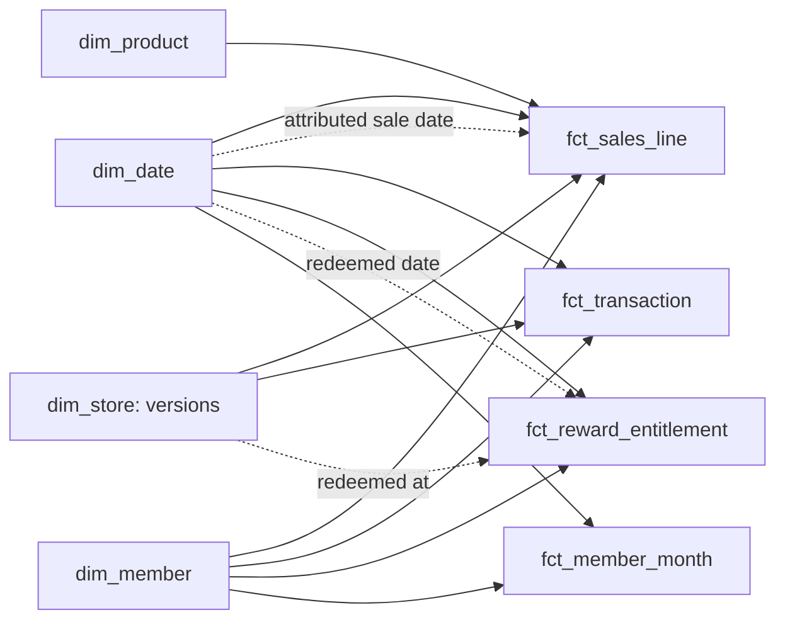

# Power BI

A Power BI Project (PBIP) whose semantic model is plain text (TMDL), so every table, relationship, measure and role is reviewable in Git. It reads the Parquet files written by `loyalty export`, with no gateway, driver or credential.

Status: **semantic model built and reconciled** with Power BI Desktop 2.158 on 11 November 2026 ([evidence](../evidence/power-bi-reconciliation.md)). The report pages are not built yet.

## Model



Dotted lines are inactive relationships, used only through `USERELATIONSHIP` in the measure that needs them. The cohort aggregates and the test history stand alone.

| Decision | Why |
| --- | --- |
| Facts relate to the **store version** in force on their date | A region or format change re-labels later sales, not earlier ones. Filtering on "North" shows S007's sales only from 1 January 2026 |
| Two date roles for sales | `[Net Sales]` on the transaction date (finance); `[Net Sales (attributed to sale date)]` moves returns back to their sale |
| Store → entitlement relationship is **inactive** | Only redeemed entitlements have a store. Active, it would hide every unredeemed reward under a store filter or an RLS role and inflate the redemption rate. `[Redemptions]` uses it explicitly |
| Member counts are **snapshots** | `[Eligible Members]`, `[Inactive Members]` and `[Active Members]` take the last month in the filter, so a year shows September's members, not the sum of twelve months |
| Rules live in dbt, aggregation in DAX | Each rule is written once and tested ([decision 0007](../docs/decisions/0007-metric-logic-dbt-and-dax.md)) |
| `discourageImplicitMeasures` | Report authors use the defined measures, not ad-hoc sums of columns |

Measures are grouped in display folders: Sales, Stores, Baskets, Members, Rewards, Cohorts, Data quality, Freshness. Every measure has a description, taken from [metrics.md](../docs/metrics.md).

## Row-level security

Two static roles, `Region North` and `Region London`, filter `dim_store` by region. Sales and baskets follow through the store relationship. Member, reward and cohort figures are programme-wide and deliberately not filtered. The reconciliation tests both the allowed rows and the denied ones. These roles are a design demonstration, tested on Power BI Desktop's engine. Assigning people to roles needs the Power BI service, which is not used here.

## Open and reconcile

Needs Windows, Power BI Desktop and PowerShell 7.

```powershell
docker compose run --rm loyalty run-all      # or: uv run loyalty run-all
docker compose run --rm loyalty reference    # SQL reference values into exports/reference_values.json
Start-Process .\bi\RetailLoyalty.pbip        # open in Power BI Desktop; close any other Desktop window first
pwsh .\bi\reconcile.ps1                      # refresh from exports/ and compare every check
```

- **The export folder.** `ExportFolder` defaults to a placeholder. `reconcile.ps1` overrides it for its refresh only, so a machine-specific path never enters the project files. To use the report by hand, set it under Transform data > Edit parameters, and do not commit that change.
- **What is compared.** Each check in [reconciliation.json](reconciliation.json) pairs a DAX expression with SQL over the same Parquet files: money to the penny, rates to 1e-9, and a SQL null must be a blank.
- **Engine access.** The script finds the engine behind the Desktop window that holds this model, on 127.0.0.1. It downloads Microsoft's ADOMD.NET client from NuGet into `bi/.tools`, ignored by Git.

## Not covered

- **Report pages.** Not built yet.
- **Power BI service.** Nothing is published, so there is no scheduled refresh and no role assignment.
- **Performance.** A comparison over the same model is still to do.
