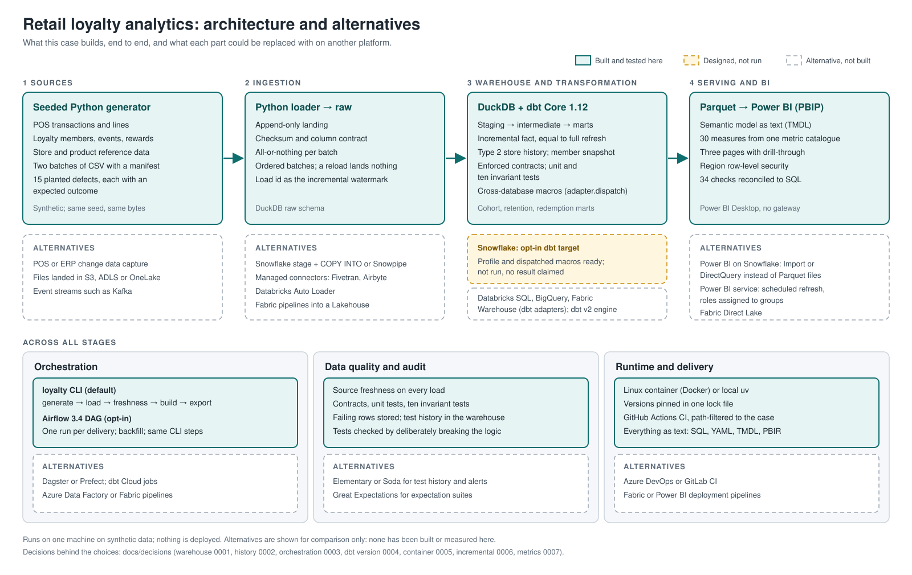
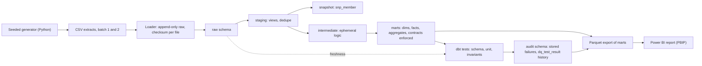
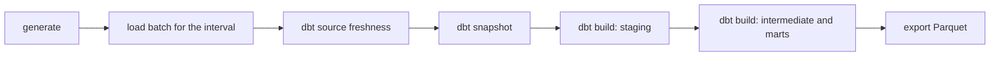

# Architecture

Status: built, 12 November 2026. Nothing is deployed; the only topology is one laptop.

## Overview and alternatives

Solid boxes are built and tested here. The amber box, Snowflake as a dbt target, is designed but has not been run. Dashed boxes are alternatives that have not been built. A [PNG copy](architecture-overview.png) is kept for places that do not show SVG.

## Data flow

| Component | Default path | Why it earns its place |
| --- | --- | --- |
| Generator | Python standard library, seeded | Deterministic extracts with planted defects. No Faker: the data holds no names or addresses, so it would add a dependency for nothing |
| Loader | Python and DuckDB | Shows append-only landing with batch metadata and idempotent reloads, which reading files directly as dbt sources would hide |
| Warehouse | DuckDB file in the case folder | Runs in-process with no account, so a reviewer and CI run exactly what is documented ([decision 0001](decisions/0001-warehouse-target.md)) |
| Transformation | dbt-core with dbt-duckdb | Layered models, documentation, schema tests, unit tests and incremental materialisation |
| Orchestration | One CLI command running generate, load, snapshot, build and export in order; Airflow opt-in, see below | The default path stays free of Docker; Airflow adds scheduling, per-batch intervals and backfill for those who opt in ([decision 0003](decisions/0003-orchestration.md)) |
| Data quality | dbt source freshness, enforced contracts on marts, schema tests, unit tests, singular invariant tests with `store_failures`, and an `on-run-end` hook appending every result to `audit.dq_test_result` | Freshness catches stale input, contracts catch breaking changes, invariants catch wrong business logic, stored failures show which rows failed, the history shows when |
| Export | `loyalty export`: every mart and the test history to Parquet in `exports/` | Power BI reads typed files with no driver or credential; decimals stay exact |
| BI | Power BI Desktop, saved as a PBIP project | Text-based semantic model (TMDL) that diffs in Git. Reads Parquet exports, so no driver or credential is involved |
| Runtime | A Linux image (`Dockerfile`) and Compose service, or local Python with uv; both from `uv.lock` | Development on Windows meets Linux behaviour before CI does; a reviewer without Docker can still run it ([decision 0005](decisions/0005-linux-container.md)) |
| CI | [GitHub Actions](../../../.github/workflows/case-02-ci.yml), path-filtered to this case | Lint; dbt parse with deprecations as errors; `run-all` from an empty warehouse; all tests; the image builds. The test history is kept as a job artefact |

## Opt-in: Snowflake

A second dbt target, `snowflake`, in `profiles.example.yml`. It is **not built or run yet**, and the case will not claim Snowflake execution until a run is recorded in `evidence/`.

- **What changes:** the profile, and a loader path that stages the extracts and runs `COPY INTO`. Models stay the same.
- **Portability:** models use dbt's cross-database macros (`dbt.dateadd`, `dbt.datediff`, `dbt.date_trunc`, `dbt.date_spine`). Each is dispatched: dbt looks for `snowflake__datediff`, then `duckdb__datediff`, then `default__datediff`, and the adapter packages supply the right SQL. Where this case needs SQL that differs by engine and dbt has no macro, it adds its own `adapter.dispatch` macro with a `default__` and a `duckdb__` or `snowflake__` implementation, instead of branching on `target.type` inside a model.
- **Credentials:** read from environment variables, never written to a file in the repository.

## Opt-in: Airflow

An [`orchestration/`](../orchestration/README.md) folder with its own Docker Compose file: Airflow 3.4.0 standalone and a PostgreSQL metadata database. Not needed for the default path, CI or any result in the README except A15. SQLite was tried first and dropped: the scheduler, DAG processor and CLI write at once, and a backfill failed with "database is locked".

- **One run per batch.** An `EventsTimetable` schedules a run on each delivery date, and the run's logical date selects its batch, so a backfill over September replays batch 1 then batch 2, in order. Order matters because the snapshot records state as of each run.
- **Rerun safety.** Clearing and rerunning an interval reloads nothing (checksums), the snapshot records no new versions, and the incremental merge rewrites the same rows. A15 checks this.
- **Tasks call dbt by layer** with `dbt build --select`, so each layer is tested before the next runs. Rendering every model as a task (for example with Cosmos) is left out: another dependency and a noisy graph for about twenty models.
- **One task at a time,** because DuckDB allows one writer. On Snowflake the marts could run in parallel.
- **CI** builds the Airflow image and checks that the DAG imports with the agreed shape; it does not start Airflow.
- **Measured on 11 November 2026** ([verify_a15.sh](../orchestration/verify_a15.sh)): the backfill created two runs and both succeeded, batch 1 then batch 2. All 11 marts equal those of `run-all` built separately. Clearing and rerunning 30 September changed no mart and rewrote no row.

## Run, data interval and recovery

Each load records the batch, files, checksums, row counts and load time in `raw._load_log`. dbt's run results are kept per build as evidence. A failed load leaves no partial batch: every file is validated first, then the whole batch loads in one transaction. A failed build leaves the previous marts in place, and rerunning is safe because raw is append-only and the incremental fact merges on its key.

## Production design, not built

At a real retailer the extracts would land in object storage from the till and programme systems, a warehouse such as Snowflake would load them on arrival, and dbt would run on a schedule with freshness checks on each source. None of this is demonstrated here.
