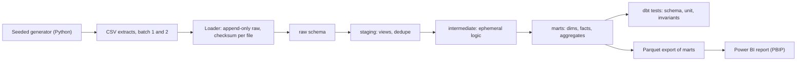

# Architecture

Status: agreed design, 11 November 2026. Nothing is deployed; the only topology is one laptop.

## Data flow

| Component | Default path | Why it earns its place |
| --- | --- | --- |
| Generator | Python standard library, seeded | Deterministic extracts with planted defects. No Faker: the data holds no names or addresses, so it would add a dependency for nothing |
| Loader | Python and DuckDB | Shows append-only landing with batch metadata and idempotent reloads, which reading files directly as dbt sources would hide |
| Warehouse | DuckDB file in the case folder | Runs in-process with no account, so a reviewer and CI run exactly what is documented ([decision 0001](decisions/0001-warehouse-target.md)) |
| Transformation | dbt-core with dbt-duckdb | Layered models, documentation, schema tests, unit tests and incremental materialisation |
| Orchestration | One CLI command running generate, load, build and export in order | A linear four-step job does not need a scheduler. Airflow would add a service and teach nothing here |
| BI | Power BI Desktop, saved as a PBIP project | Text-based semantic model (TMDL) that diffs in Git. Reads Parquet exports, so no driver or credential is involved |
| CI | GitHub Actions, path-filtered to this case | Generate, load, build and test on every pull request |

## Opt-in: Snowflake

A second dbt target, `snowflake`, in `profiles.example.yml`. It is **not built or run yet**, and the case will not claim Snowflake execution until a run is recorded in `evidence/`.

- **What changes:** the profile, and a loader path that stages the extracts and runs `COPY INTO`. Models stay the same.
- **Portability:** models use dbt's cross-database macros (`dbt.dateadd`, `dbt.datediff`, `dbt.date_trunc`, `dbt.date_spine`). Each is dispatched: dbt looks for `snowflake__datediff`, then `duckdb__datediff`, then `default__datediff`, and the adapter packages supply the right SQL. Where this case needs SQL that differs by engine and dbt has no macro, it adds its own `adapter.dispatch` macro with a `default__` and a `duckdb__` or `snowflake__` implementation, instead of branching on `target.type` inside a model.
- **Credentials:** read from environment variables, never written to a file in the repository.

## Run, data interval and recovery

Each load records the batch, files, checksums, row counts and load time in `raw._load_log`. dbt's run results are kept per build as evidence. A failed load leaves no partial batch: each file loads in one transaction. A failed build leaves the previous marts in place, and rerunning is safe because raw is append-only and the incremental fact merges on its key.

## Production design, not built

At a real retailer the extracts would land in object storage from the till and programme systems, a warehouse such as Snowflake would load them on arrival, and dbt would run on a schedule with freshness checks on each source. None of this is demonstrated here.
