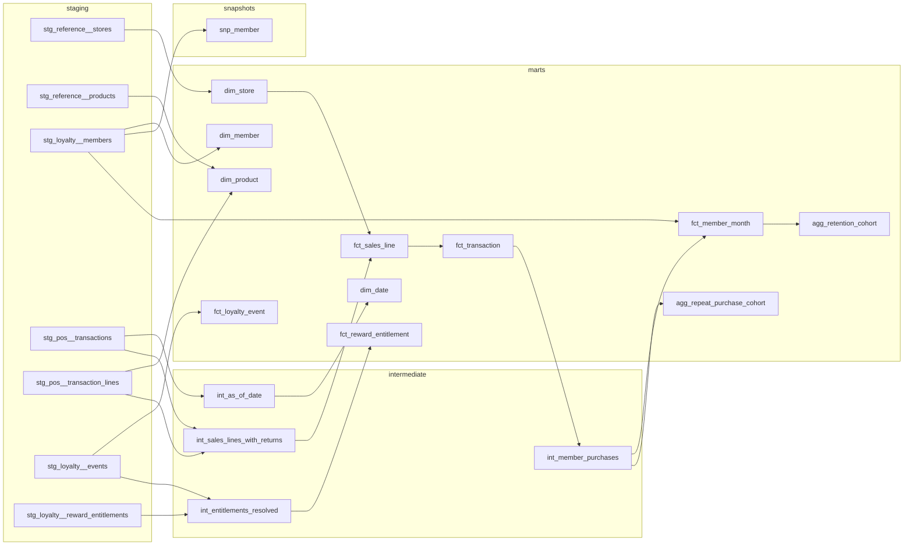

# Data model

Status: agreed design, 11 November 2026. No models exist yet.

## Sources

All synthetic, written by a seeded generator as CSV extracts in two batches. Source names are generic: `pos` for the tills, `loyalty` for the programme, `reference` for master data.

| Source table | Grain | Business key | Change pattern | Rows, batch 1 + batch 2 |
| --- | --- | --- | --- | --- |
| `reference.stores` | One row per store per attribute version | `store_id`, `effective_from_date` | Full extract each batch; each version carries the date it took effect | 14 + 15 (12 stores, 15 versions) |
| `reference.products` | One row per product | `product_id` | Full extract each batch; one product arrives late | 60 + 61 |
| `loyalty.members` | One row per member, latest state | `member_id` | Batch 1 full; later batches send new and corrected members | 5,905 + 102 |
| `pos.transactions` | One row per till transaction (sale or return) | `transaction_id` | Re-delivered with a later `updated_at` when corrected | 53,487 + 1,291 |
| `pos.transaction_lines` | One row per line of a transaction | `transaction_id`, `line_number` | Delivered with its transaction | 115,565 + 2,813 |
| `loyalty.events` | One row per programme event | `event_id` | Append-only; duplicates happen | 53,815 + 1,225 |
| `loyalty.reward_entitlements` | One row per reward issued to a member, latest state | `entitlement_id` | Batch 1 full; later batches send entitlements issued or changed | 14,474 + 391 |

Measured from seed 2602 on 11 November 2026, including the planted duplicates.

**Observation period:** 1 October 2024 to 30 September 2026. **Batch 1** holds everything up to 16 September 2026. **Batch 2** holds the last fortnight plus the late material listed below. The as-of date is the latest transaction date loaded; a dbt variable can override it.

## Raw layer

A Python loader ([loader.py](../src/loyalty/loader.py)) appends each extract to a `raw` table, every value as delivered text, plus `_load_id`, `_batch_id`, `_source_file`, `_file_checksum` and `_loaded_at`. `_load_id` rises with every file loaded, and is the incremental watermark: it does not depend on a clock. Before writing, each file is checked against its manifest (checksum, row count) and against the column contract in [config.py](../src/loyalty/config.py); then the whole batch lands in one transaction. A file whose checksum is already in `raw._load_log` is skipped, so loading the same batch twice lands nothing. Batches must arrive in order. Staging deduplicates; raw keeps every delivery as evidence.

## Planted defects

The generator plants each defect on named records with an expected outcome, so a test can assert the exact result. The records and expectations are declared once, in [scenarios.py](../src/loyalty/scenarios.py). Planted records have their own id ranges and receive only the records listed there. The background population is generated cleanly, and [tests](../tests/test_generator.py) check that it is, so any other anomaly is a defect in the models.

| # | Defect | Why it is realistic | Expected handling | Caught by |
| --- | --- | --- | --- | --- |
| D1 | A transaction and its lines delivered twice, identical | Extract retried after a timeout | Kept once | Invariant 1; unique key on `fct_sales_line` |
| D2 | A loyalty event delivered twice with the same `event_id` | At-least-once event export | Kept once | Unique key on `fct_loyalty_event` |
| D3 | One purchase with an earn, a bonus and a redemption event | Normal programme behaviour | Revenue counted once | Invariants 2 and 4 |
| D4 | Partial and full returns, some in batch 2 for batch 1 sales | Customers return goods weeks later | Negative lines on the return date; attributed back to the original sale | Invariants 1 and 3 |
| D5 | A return whose original sale is not in the extract | Sale before the observation period, or keyed in wrongly | Kept, flagged unmatched, attributed to the return date | Invariant 3; planted record |
| D6 | A return of more units than were sold | Till error | Kept and flagged | Invariant 8 |
| D7 | Anonymous transactions with no member | Most shoppers do not scan a card | Counted in sales, excluded from member metrics | Planted records; member share metric |
| D8 | Members who enrol and never buy | Common in loyalty programmes | Present in `fct_member_month`; inactive once eligible | Invariant 7; acceptance A3 |
| D9 | A store changes format, another changes region, one opens mid-period | Refits and reorganisations | Store versions; sales use the version in force | Invariants 5 and 6; A7 |
| D10 | A product sold in batch 1 whose reference row arrives in batch 2 | Master data lags the tills | Inferred product row, completed when the row arrives | A8 |
| D11 | A transaction re-delivered in batch 2 with a member attached | Card scanned after the sale, claimed at the desk | Member linked; earlier marts change, incremental equals full refresh | A6 |
| D12 | A member's enrolment date corrected in batch 2 | Back-office correction | Cohort assignment moves | A6 |
| D13 | An entitlement still `issued` although a redemption event exists | Status column updated by a separate job that failed | Resolved as redeemed from the event log, flagged | Invariant 9; A9 |
| D14 | An entitlement still `issued` long after it expired | Nothing ever closes expired rewards | Resolved as expired | Invariant 9 |
| D15 | Members enrolled in the last weeks before the as-of date | Every live programme has them | Cohorts marked immature | Invariant 10; A4 |

## Model DAG

Staging models are views: one per source table, renaming, casting and deduplicating, with no joins. Intermediate models are ephemeral and hold the business logic; `int_as_of_date` is the one date every window and maturity rule is measured against. `dim_store` builds its versions directly from staging: the logic is one window function, and an intermediate model would only make it harder to unit test. Marts are tables, except `fct_sales_line`, which is incremental. `snp_member` is a dbt snapshot, run after each batch is loaded.

## Mart grain

Agreed before any SQL. Every mart's dbt description repeats its grain in the first sentence.

| Model | One row per | Key | Type |
| --- | --- | --- | --- |
| `dim_date` | Calendar date in the observation period | `date_day` | Dimension |
| `dim_store` | Store per attribute version | `store_version_id` (store and valid-from) | Type 2 history |
| `dim_product` | Product, including inferred products not yet in reference data | `product_id` | Type 1 |
| `dim_member` | Member, current attributes after corrections | `member_id` | Type 1 |
| `fct_sales_line` | Transaction line, sale or return | `sales_line_id` (transaction and line number) | Transaction fact, **incremental** |
| `fct_transaction` | Till transaction, sale or return | `transaction_id` | Transaction fact |
| `fct_loyalty_event` | Distinct programme event | `event_id` | Event fact, no amounts |
| `fct_reward_entitlement` | Entitlement, with its milestone dates | `entitlement_id` | Accumulating snapshot |
| `fct_member_month` | Member per calendar month, from the enrolment month to the as-of month | `member_id`, `month_start_date` | Periodic snapshot, dense |
| `agg_repeat_purchase_cohort` | Month of a member's first purchase | `cohort_month` | Aggregate |
| `agg_retention_cohort` | Enrolment month and months since enrolment | `cohort_month`, `months_since_enrolment` | Aggregate |
| `snp_member` | Member per version as known to the warehouse, from one snapshot run to the next | `dbt_scd_id` | dbt snapshot, `timestamp` strategy on `updated_at` |
| `agg_data_quality_run` | dbt invocation and test | `invocation_id`, `test_name` | Audit, from stored test failures |

### Why these grains

- **Header, line and event grains stay separate.** Amounts live on `fct_sales_line` and roll up to `fct_transaction`. `fct_loyalty_event` carries points but no money, so joining events to sales can never multiply revenue; anything that needs both aggregates events to the transaction first.
- **A return is its own transaction**, with negative lines that reference the original line. One fact therefore serves both date bases: the return date for finance, the original sale date for cohort and product views.
- **`fct_member_month` is dense on purpose.** Inactivity is about months in which nothing happened, so a member with no purchases must still have rows. Its size is members × months, which is fine here and is the first thing to change at scale.
- **`fct_reward_entitlement` is one row per entitlement**, not per status change, because the redemption-rate denominator is entitlements, and the milestone dates (issued, redeemed, expired) are all the history the metric needs.

## History and late data

Two kinds of history, deliberately kept apart ([decision 0002](decisions/0002-history-strategy.md)):

- **Stores, business history:** the source sends each attribute version with the date it took effect, and raw keeps every delivery, so `dim_store` is rebuilt from raw on every run. Facts look up the version in force on the transaction date. A snapshot is not used here, because a snapshot records changes only when it runs and could not reproduce versions dated before the first run.
- **Members, what the warehouse knew:** members arrive as latest state, and a correction overwrites the earlier value. `dim_member` is type 1, so reports always use the corrected value. `snp_member` records each state as it was known after each batch, which answers "what did we report before the correction?". It is the right tool here because the source does not keep that history. Its limitation is stated in the README: it holds only the states that existed when it ran, so a clean clone rebuilds it by replaying the batches in order.
- **Transactions:** re-delivered rows carry a later `updated_at`; staging keeps the latest per key.
- **Products:** a line whose product is unknown gets an inferred `dim_product` row (`is_inferred = true`, name "Unknown product <id>"). When the reference row arrives, the next build replaces it, and the facts need no change because they hold the business key.
- **Incremental fact:** `fct_sales_line` reprocesses whole transactions chosen by load, not by date: those whose header or lines arrived since its last build, the returns that depend on them, and sales whose store version changed. `delete+insert` on `transaction_id` replaces all of a transaction's lines. Parity with a full refresh is tested after batch 2, after a late store version and after a late sale ([decision 0006](decisions/0006-incremental-boundary.md)).

## Unknown and missing members

| Case | Treatment |
| --- | --- |
| Anonymous transaction | `member_id` null, `is_member_sale = false`; excluded from member metrics, included in sales |
| Product not in reference data | Inferred `dim_product` row |
| Return without an original sale | `original_transaction_id` kept, `is_unmatched_return = true`, attributed to the return date |
| Store missing for a date | Not expected; the join test (invariant 6) fails the build |

## Types and money

Amounts are `decimal(18,2)` in pounds sterling, with a `currency_code` column fixed to `GBP` and tested. Quantities are integers, negative on return lines. Timestamps are local store time without a zone; dates end `_date`, timestamps end `_at`.
