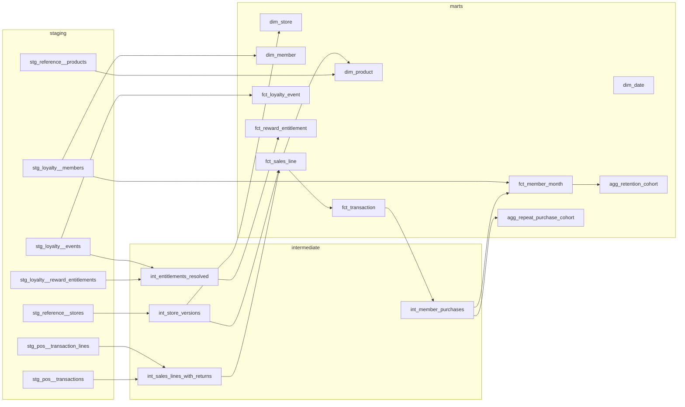

# Data model

Status: agreed design, 11 November 2026. No models exist yet.

## Sources

All synthetic, written by a seeded generator as CSV extracts in two batches. Source names are generic: `pos` for the tills, `loyalty` for the programme, `reference` for master data.

| Source table | Grain | Business key | Change pattern | Approximate rows |
| --- | --- | --- | --- | --- |
| `reference.stores` | One row per store per attribute version | `store_id`, `updated_at` | Each version delivered with the date it took effect | 12 stores, about 16 versions |
| `reference.products` | One row per product | `product_id` | Current state; some products arrive late | 60 |
| `loyalty.members` | One row per member, latest state | `member_id` | Re-delivered with a later `updated_at` when corrected | 6,000 |
| `pos.transactions` | One row per till transaction (sale or return) | `transaction_id` | Re-delivered with a later `updated_at` when corrected | 45,000 |
| `pos.transaction_lines` | One row per line of a transaction | `transaction_id`, `line_number` | Delivered with its transaction | 110,000 |
| `loyalty.events` | One row per programme event | `event_id` | Append-only; duplicates happen | 75,000 |
| `loyalty.reward_entitlements` | One row per reward issued to a member, latest state | `entitlement_id` | Re-delivered when the status changes | 9,000 |

Row counts are targets for the generator, to be replaced by measured counts.

**Observation period:** 1 October 2024 to 30 September 2026. **Batch 1** holds everything up to 16 September 2026. **Batch 2** holds the last fortnight plus the late material listed below. The as-of date is the latest transaction date loaded; a dbt variable can override it.

## Raw layer

A Python loader appends each extract to a `raw` table with `_batch_id`, `_source_file`, `_file_checksum` and `_loaded_at`. Raw is append-only. A file whose checksum is already loaded is skipped, so loading the same batch twice lands nothing. Staging deduplicates; raw keeps every delivery as evidence.

## Planted defects

The generator plants each defect on named records with an expected outcome, as case 06 did, so a test can assert the exact result. The background population is generated cleanly, so any other anomaly is a defect in the models.

| # | Defect | Why it is realistic | Expected handling | Caught by |
| --- | --- | --- | --- | --- |
| D1 | A transaction and its lines delivered twice, identical | Extract retried after a timeout | Kept once | Invariant 1; unique key on `fct_sales_line` |
| D2 | A loyalty event delivered twice with the same `event_id` | At-least-once event export | Kept once | Unique key on `fct_loyalty_event` |
| D3 | One purchase with an earn, a bonus and a redemption event | Normal programme behaviour | Revenue counted once | Invariants 2 and 4 |
| D4 | Partial and full returns, some in batch 2 for batch 1 sales | Customers return goods weeks later | Negative lines on the return date; attributed back to the original sale | Invariants 1 and 3 |
| D5 | A return whose original sale is not in the extract | Sale before the observation period, or keyed in wrongly | Kept, flagged unmatched, attributed to the return date | Invariant 3; planted record |
| D6 | A return of more units than were sold | Till error | Kept and flagged | Invariant 8 |
| D7 | Anonymous transactions with no member | Most shoppers do not scan a card | Counted in sales, excluded from member metrics | Planted records; member share metric |
| D8 | Members who enrol and never buy | Common in loyalty programmes | Present in `fct_member_month`; inactive once eligible | Invariant 7; acceptance A3 |
| D9 | A store changes format, another changes region, one opens mid-period | Refits and reorganisations | Store versions; sales use the version in force | Invariants 5 and 6; A7 |
| D10 | A product sold in batch 1 whose reference row arrives in batch 2 | Master data lags the tills | Inferred product row, completed when the row arrives | A8 |
| D11 | A transaction re-delivered in batch 2 with a member attached | Card scanned after the sale, claimed at the desk | Member linked; earlier marts change, incremental equals full refresh | A6 |
| D12 | A member's enrolment date corrected in batch 2 | Back-office correction | Cohort assignment moves | A6 |
| D13 | An entitlement still `issued` although a redemption event exists | Status column updated by a separate job that failed | Resolved as redeemed from the event log, flagged | Invariant 9; A9 |
| D14 | An entitlement still `issued` long after it expired | Nothing ever closes expired rewards | Resolved as expired | Invariant 9 |
| D15 | Members enrolled in the last weeks before the as-of date | Every live programme has them | Cohorts marked immature | Invariant 10; A4 |

## Model DAG

Staging models are views: one per source table, renaming, casting and deduplicating, with no joins. Intermediate models are ephemeral and hold the business logic. Marts are tables, except `fct_sales_line`, which is incremental.

## Mart grain

Agreed before any SQL. Every mart's dbt description repeats its grain in the first sentence.

| Model | One row per | Key | Type |
| --- | --- | --- | --- |
| `dim_date` | Calendar date in the observation period | `date_day` | Dimension |
| `dim_store` | Store per attribute version | `store_version_id` (store and valid-from) | Type 2 history |
| `dim_product` | Product, including inferred products not yet in reference data | `product_id` | Type 1 |
| `dim_member` | Member, current attributes after corrections | `member_id` | Type 1 |
| `fct_sales_line` | Transaction line, sale or return | `sales_line_id` (transaction and line number) | Transaction fact, **incremental** |
| `fct_transaction` | Till transaction, sale or return | `transaction_id` | Transaction fact |
| `fct_loyalty_event` | Distinct programme event | `event_id` | Event fact, no amounts |
| `fct_reward_entitlement` | Entitlement, with its milestone dates | `entitlement_id` | Accumulating snapshot |
| `fct_member_month` | Member per calendar month, from the enrolment month to the as-of month | `member_id`, `month_start_date` | Periodic snapshot, dense |
| `agg_repeat_purchase_cohort` | Month of a member's first purchase | `cohort_month` | Aggregate |
| `agg_retention_cohort` | Enrolment month and months since enrolment | `cohort_month`, `months_since_enrolment` | Aggregate |

### Why these grains

- **Header, line and event grains stay separate.** Amounts live on `fct_sales_line` and roll up to `fct_transaction`. `fct_loyalty_event` carries points but no money, so joining events to sales can never multiply revenue; anything that needs both aggregates events to the transaction first.
- **A return is its own transaction**, with negative lines that reference the original line. One fact therefore serves both date bases: the return date for finance, the original sale date for cohort and product views.
- **`fct_member_month` is dense on purpose.** Inactivity is about months in which nothing happened, so a member with no purchases must still have rows. Its size is members × months, which is fine here and is the first thing to change at scale.
- **`fct_reward_entitlement` is one row per entitlement**, not per status change, because the redemption-rate denominator is entitlements, and the milestone dates (issued, redeemed, expired) are all the history the metric needs.

## History and late data

- **Stores:** the source sends each attribute version with the date it took effect, and raw keeps every delivery, so `dim_store` is rebuilt from raw on every run. A dbt snapshot is not used: it records changes only when it runs, and could not be rebuilt from a clean clone. Facts look up the version in force on the transaction date.
- **Members and transactions:** re-delivered rows carry a later `updated_at`; staging keeps the latest per key. Corrections are type 1: the mart shows the corrected value everywhere.
- **Products:** a line whose product is unknown gets an inferred `dim_product` row (`is_inferred = true`, name "Unknown product <id>"). When the reference row arrives, the next build replaces it, and the facts need no change because they hold the business key.
- **Incremental fact:** `fct_sales_line` processes the transactions loaded since its last build, by load time, not by transaction date, so a late row is caught whatever date it carries. It merges on `sales_line_id`. A correction to a transaction header rewrites that transaction's lines. Parity with a full refresh is tested after batch 2.

## Unknown and missing members

| Case | Treatment |
| --- | --- |
| Anonymous transaction | `member_id` null, `is_member_sale = false`; excluded from member metrics, included in sales |
| Product not in reference data | Inferred `dim_product` row |
| Return without an original sale | `original_transaction_id` kept, `is_unmatched_return = true`, attributed to the return date |
| Store missing for a date | Not expected; the join test (invariant 6) fails the build |

## Types and money

Amounts are `decimal(18,2)` in pounds sterling, with a `currency_code` column fixed to `GBP` and tested. Quantities are integers, negative on return lines. Timestamps are local store time without a zone; dates end `_date`, timestamps end `_at`.
