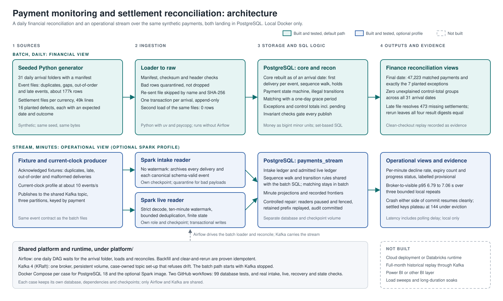

# Payment monitoring and settlement reconciliation

**Validated local MVP.** Batch reconciliation, shared Airflow late-file recovery, Kafka/Spark intake and live SQL views, checkpoint/crash recovery, bounded late backfill, finite state eviction and current-clock measurement are implemented and evidenced. The [final review](evidence/final-review-run.md) built both images from a clean committed checkout, passed all 99 tests and all four real streaming checks, and verified cleanup. The [measurement report](evidence/stream-measurement-run.md) records three local repeats with broker-to-visible p95 of 6.79–7.06 seconds at roughly ten events/second. No cloud deployment is claimed.

A fictional payment provider needs two views of the same payments: an operational one, within minutes, of what is failing; and a financial one, daily, proving that every captured payment was settled correctly and explaining every difference. The events arrive duplicated, out of order and late.

Stack:

- **Batch (milestone 1):** PostgreSQL with Python, orchestrated by the shared portfolio Airflow.
- **Streaming:** shared Kafka (KRaft), optional Spark intake/live readers, acknowledged fixtures, SQL operational views and bounded controlled backfill.
- **Runtime:** Docker is required ([decision 0003](docs/decisions/0003-docker-required.md)).



Teal boxes are the default path; blue boxes are the optional Spark profile; the dashed box lists what is not built. Details and the component table are in the [architecture note](docs/architecture.md).

## Recorded results

All results use synthetic data. Counts and timings describe the linked fixtures, rather than business impact.

| Question | Observed result | Evidence |
| --- | --- | --- |
| Does the batch explain settlement differences? | 47,223 matched payments and exactly seven planted exceptions on the final date; zero unexplained control-total groups across 31 arrival dates | [Clean batch replay](evidence/batch-clean-setup-run.md) |
| Is late-file recovery safe to rerun? | The delayed file resolves the planted missing settlements; rerun preserves all four result-table digests | [Shared Airflow recovery](evidence/airflow-late-file-run.md) |
| Can the stream recover without inflating output? | Injected exits on both sides of database commit resume the same checkpoint; bounded late repair agrees with batch | [Crash and backfill checks](evidence/stream-recovery-run.md) |
| Is state eviction observed? | Settled keys plateau at 144 across five evictions while admitted history grows to 384 events | [Finite A12 profile](evidence/stream-state-run.md) |
| How fast is the declared small live profile? | Three repeats, 600 measured events each at roughly ten events/second; broker-to-visible p95 6.79–7.06 seconds, including polling delay | [Current-clock measurement](evidence/stream-measurement-run.md) |

## Run it

Docker is the only requirement. From this folder:

```sh
cp .env.example .env                        # then choose your own POSTGRES_PASSWORD
docker compose build payrecon               # install the locked environment for this checkout
docker compose up -d --wait postgres
docker compose run --rm payrecon generate   # 31 arrival folders under data/generated (about 15 s)
docker compose run --rm payrecon migrate
docker compose run --rm payrecon load --arrival all
docker compose run --rm payrecon build-core       # as of the latest arrival, or --arrival YYYY-MM-DD
docker compose run --rm payrecon reconcile        # builds core and reconciles, same --arrival option
docker compose run --rm payrecon run-all          # or replay every day in order: load, then reconcile (about 3 min)
docker compose run --rm --entrypoint pytest payrecon -q
```

The [CI workflow](../../.github/workflows/case-03-ci.yml) runs the locked Linux image against a disposable PostgreSQL service, with database tests required rather than skipped. See [test guidance](tests/README.md) for the same requirement locally. DAG checks run separately in the shared platform workflow.

`load` is safe to repeat: a file already landed with the same name and checksum is skipped. `build-core` rebuilds core from everything that had arrived by a date, so rerunning a day gives the same result. `reconcile` fails, and publishes nothing, if any invariant check fails. A payment or unmatched line waits one grace day before it becomes an exception ([decision 0005](docs/decisions/0005-reconciliation-runs-and-grace.md)). `payrecon reset --yes` drops the case's schemas in the selected database, including stream state if present, then applies batch migrations. For the optional streaming image, separate database and checkpoint precautions, follow the [intake run guide](streaming/README.md).

## Start here

- [Final MVP review and handoff](evidence/final-review-run.md): clean source, 99 tests, all real streaming checks, resolved cleanup finding and completed scope
- [Clean batch setup and review](evidence/batch-clean-setup-run.md): isolated committed checkout, 31 arrivals, exact fixture counts and remaining limits
- [Streaming run guide and checks](streaming/README.md): optional runtime, quarantine, intake/live checkpoints, minute views and phased replay
- [Current-clock measurement](evidence/stream-measurement-run.md): three bounded local repeats, observed latency, actual offered/output rates and polling uncertainty
- [Streaming design](docs/streaming-design.md): implemented intake/live boundaries, confirmed metric/lateness choices and controlled recovery limits
- [Airflow recovery evidence](evidence/airflow-late-file-run.md): late-file recovery and unchanged results on rerun
- [CI validation evidence](evidence/ci-local-run.md): initial database CI baseline; the final review records the current 99-test suite
- [Requirements](docs/requirements.md): decisions, settlement rules, acceptance criteria, invariants
- [Data model](docs/data-model.md): sources, planted defects, payment state machine, grain of every table
- [Metrics](docs/metrics.md)
- [Architecture](docs/architecture.md)
- [Decisions](docs/decisions/README.md)

## Limits and trade-offs

Core is rebuilt from raw for each arrival date, which makes late corrections and historical reruns straightforward at this fixture size. Larger workloads would need incremental processing with equivalent recovery checks. Only one writer may target a case database at a time: Airflow serialises its runs, but concurrent CLI writers are not blocked by a database lock.

Merchant pricing uses the latest reference data available to each as-of build; historical price-plan versions are not modelled. This is a local Docker demonstration, with no high availability or cloud deployment. State eviction is validated for a finite fixed-density profile, not arbitrary input rates, total RAM or retention expiry. Measurement covers short warmed single-live-reader runs; it includes observer delay and does not establish maximum capacity or concurrent intake/live performance. The live sink rewalks affected histories through one driver/database; repair requires complete retained input for a bounded prefix. This is not a distributed sink benchmark or general broker-loss recovery system. See [measurement limits](evidence/stream-measurement-run.md), [state limits](evidence/stream-state-run.md), [recovery limits](evidence/stream-recovery-run.md) and [metrics](docs/metrics.md).

[Return to portfolio](../../README.md).
