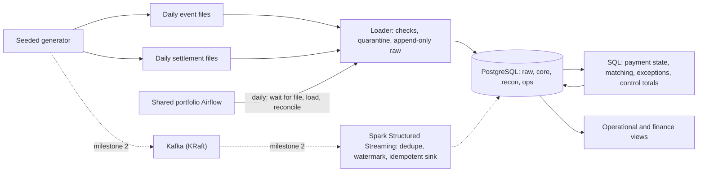

# Architecture

Status: design proposed, 12 November 2026. Nothing is built or deployed; the only topology is one laptop.

| Component | Choice | Why it earns its place |
| --- | --- | --- |
| Storage and reconciliation | PostgreSQL 18 in Docker | Transactions, exact `bigint` money, and set-based SQL for matching. It is also the sink the stream writes to |
| Loader and generator | Python, run with uv | Validated landing with a quarantine route; deterministic data |
| Orchestration | The shared portfolio Airflow ([decision 0001](decisions/0001-shared-airflow.md)) | Settlement is a daily, file-driven, retryable process, which is Airflow's job. It schedules files and runs, not individual events |
| Streaming (milestone 2) | Kafka 4 (KRaft) and Spark Structured Streaming | Event time, watermarks, checkpoints and replay are the point of the case. Versions are checked before pinning |
| Runtime | Docker Compose for PostgreSQL and Kafka; a Python CLI that also runs in a container | This case needs services. Unlike case 02, Docker is required ([decision 0003](decisions/0003-docker-required.md)) |

## Shared Airflow

- **One stack for the portfolio.** It moves from case 02's `orchestration/` folder to `platform/airflow/`.
- **Mounts:** each case's `dags/` folder, and the case's own Python environment, so case dependencies never mix with Airflow's.
- **Network:** case services such as this PostgreSQL join an external Docker network, `portfolio`, so Airflow can reach them by name.
- **Every case still runs without Airflow,** through its own CLI.

## Memory budget

Docker has 7.7 GB on this laptop. Airflow takes about 2–3 GB, PostgreSQL under 0.5 GB, Kafka about 1 GB, and Spark in local mode about 1.5 GB. Milestone 1 needs only Airflow and PostgreSQL. In milestone 2 Airflow can be stopped while the stream runs, if memory is short.
