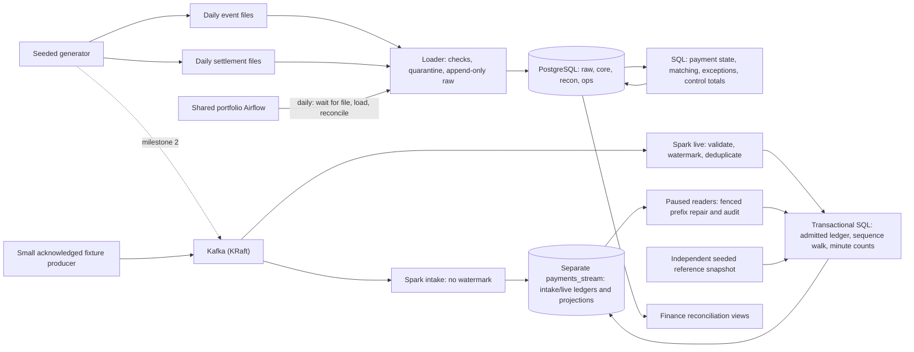

# Architecture

Status: 12 November 2026. Batch, shared Kafka and Spark intake/live have passing GitHub checks. Bounded controlled backfill and abrupt consumer-recovery checks are implemented; sustained eviction and measurement remain outstanding. No cloud deployment exists.

Infrastructure ownership follows [portfolio decision 0001](../../../platform/decisions/0001-shared-infrastructure.md). Airflow and Kafka are shared in `platform/airflow/` and `platform/kafka/`. Case 03 retains its PostgreSQL, jobs, dependency environment and processing state.

| Component | Choice | Why it earns its place |
| --- | --- | --- |
| Storage and reconciliation | PostgreSQL 18 in Docker | Transactions, exact `bigint` money, and set-based SQL for matching. It is also the sink the stream writes to |
| Loader and generator | Python, run with uv | Validated landing with a quarantine route; deterministic data |
| Orchestration | The shared portfolio Airflow ([decision 0001](decisions/0001-shared-airflow.md)) | Settlement is a daily, file-driven, retryable process, which is Airflow's job. It schedules files and runs, not individual events |
| Streaming (milestone 2) | Kafka 4 (KRaft) and Spark Structured Streaming | Event time, watermarks, checkpoints and replay are the point of the case. Versions are checked before pinning |
| Runtime | Case-owned Docker Compose for PostgreSQL and optional Spark job; portfolio Compose stacks for shared Airflow and Kafka | Case dependency groups/images and checkpoints stay separate ([decision 0008](decisions/0008-streaming-runtime-and-intake.md)) |

## Shared Airflow

- **One stack for the portfolio.** It lives in `platform/airflow/`; both Case 02 and Case 03 have isolated environments and mounted DAG folders.
- **Mounts:** each case's `dags/` folder, and the case's own Python environment, so case dependencies never mix with Airflow's.
- **Network:** this case's PostgreSQL publishes a port on the machine, and the shared Airflow reaches it at `host.docker.internal`. No network is shared between Compose projects.
- **Every case still runs without Airflow,** through its own CLI.
- **Case 03 settings:** an optional case-owned Compose override supplies namespaced connection variables, keeping the base platform usable without Case 03 credentials. Tasks read credentials only at execution. See [decision 0006](decisions/0006-batch-orchestration.md) and the [run guide](../orchestration/README.md).

## Streaming intake and live query

The [streaming design](streaming-design.md) owns the contract, grains, two-query flow and recovery policy. Intake archives every delivery and canonical schema-valid event into `payments_stream`. The independent live query validates before its ten-minute watermark and bounded deduplication, then transactionally publishes an admitted ledger and SQL projections. Both readers report their progress separately; status compares recorded frontiers and exposes missing events or reference/conflict holds. See the [run guide](../streaming/README.md) and [live decision](decisions/0009-live-state-and-operational-projections.md). Authorisation decline rate and expiry counts remain separate. Batch/live share SQL transition values and the sequence walk; matching stays in the financial batch.

Controlled repair consumes the retained intake prefix offline, with both readers paused/fenced and an explicit reference snapshot. It admits only validated missing events, reprojects the small generation and commits an audit atomically; it does not write financial tables or reset Spark checkpoints. The [recovery decision](decisions/0010-controlled-stream-recovery.md) records bounds, source-proof requirements and failure semantics.

Kafka's client network belongs to the platform ([decision 0002](../../../platform/decisions/0002-shared-kafka-topology.md)); the optional case streaming overlay joins it. This differs from Airflow's existing host-port connection and preserves Kafka-free batch startup. The case Spark job runs in local mode with its own runtime, persistent checkpoint volume and separate streaming database; there is no shared Spark service.

## Memory budget

Docker reported ~7.66 GiB and 8 logical CPUs on 12 November 2026. Milestone 1 uses PostgreSQL and optional Airflow. The streaming proposal budgets up to 1.5 GiB for Kafka and 3 GiB for the case Spark container, plus PostgreSQL/native/OS headroom, with Airflow stopped. These are unmeasured limits, not observed service peaks. The runtime compatibility and memory gates are recorded in the streaming design.
