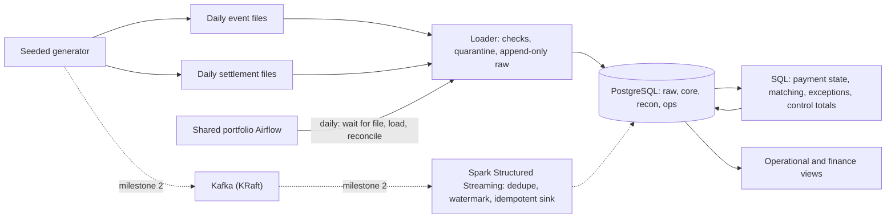

# Architecture

Status: 12 November 2026. Batch landing, core and reconciliation are implemented locally, with an opt-in DAG on the shared Airflow. Kafka and Spark remain planned. No cloud deployment exists.

Infrastructure ownership follows [portfolio decision 0001](../../../platform/decisions/0001-shared-infrastructure.md). Airflow is shared in `platform/airflow/`; Kafka will be shared in `platform/kafka/` at milestone 2. Case 03 retains its PostgreSQL, jobs, dependency environment and processing state.

| Component | Choice | Why it earns its place |
| --- | --- | --- |
| Storage and reconciliation | PostgreSQL 18 in Docker | Transactions, exact `bigint` money, and set-based SQL for matching. It is also the sink the stream writes to |
| Loader and generator | Python, run with uv | Validated landing with a quarantine route; deterministic data |
| Orchestration | The shared portfolio Airflow ([decision 0001](decisions/0001-shared-airflow.md)) | Settlement is a daily, file-driven, retryable process, which is Airflow's job. It schedules files and runs, not individual events |
| Streaming (milestone 2) | Kafka 4 (KRaft) and Spark Structured Streaming | Event time, watermarks, checkpoints and replay are the point of the case. Versions are checked before pinning |
| Runtime | Case-owned Docker Compose for PostgreSQL; portfolio Compose stacks for shared Airflow and future Kafka; a Python CLI that also runs in a container | This case needs services. Unlike case 02, Docker is required ([decision 0003](decisions/0003-docker-required.md)) |

## Shared Airflow

- **One stack for the portfolio.** It lives in `platform/airflow/`; both Case 02 and Case 03 have isolated environments and mounted DAG folders.
- **Mounts:** each case's `dags/` folder, and the case's own Python environment, so case dependencies never mix with Airflow's.
- **Network:** this case's PostgreSQL publishes a port on the machine, and the shared Airflow reaches it at `host.docker.internal`. No network is shared between Compose projects.
- **Every case still runs without Airflow,** through its own CLI.
- **Case 03 settings:** an optional case-owned Compose override supplies namespaced connection variables, keeping the base platform usable without Case 03 credentials. Tasks read credentials only at execution. See [decision 0006](decisions/0006-batch-orchestration.md) and the [run guide](../orchestration/README.md).

## Memory budget

Docker has 7.7 GB on this laptop. Airflow takes about 2–3 GB, PostgreSQL under 0.5 GB, Kafka about 1 GB, and Spark in local mode about 1.5 GB. Milestone 1 needs only Airflow and PostgreSQL. In milestone 2 Airflow can be stopped while the stream runs, if memory is short.
