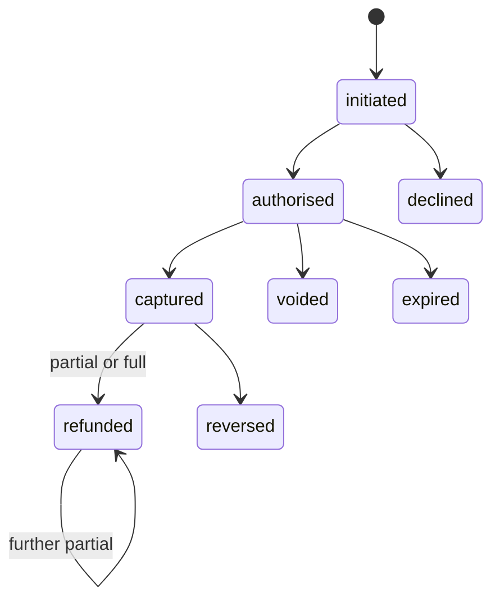

# Data model

Status: grain agreed 12 November 2026. Raw, ops, core and recon are built.

## Sources

All synthetic, from a seeded generator. In milestone 1, events arrive as daily files; in milestone 2, the same generator also publishes them to Kafka.

| Source | Grain | Business key | Notes |
| --- | --- | --- | --- |
| `payments.events` | One delivery of one payment lifecycle event | `event_id` | Carries payment id, merchant, event type, sequence number per payment, event time, ingestion time, amount in minor units, currency. Delivery is at least once and may be out of order |
| `acquirer.settlement_lines` | One line of a daily settlement file | `settlement_line_id` | One file per day per currency. Carries the payment reference, line type (sale, refund, reversal), gross, fee, net, currency and settlement date. A file may be re-sent whole |
| `reference.merchants` | One merchant | `merchant_id` | Country, settlement currency, and the price plan (basis points plus fixed fee per currency) |

The measured seed-3303 workload is recorded in the [clean batch run](../evidence/batch-clean-setup-run.md). It covers 30 payment days and 31 arrival dates, with deliberate duplicate, invalid and delayed deliveries. Use that evidence for actual counts rather than the original planning estimates.

## Payment state machine

Events are applied in order of the source's sequence number, never in order of arrival. A transition not listed here is illegal: it is not applied, and it is recorded.

`declined`, `voided`, `expired` and `reversed` are terminal states. A payment is due for settlement once it is captured. Its expected settlement is the captured amount minus refunds, and a reversal takes it to zero.

## Planted defects

Each is planted on named records with a stated outcome, so tests can assert exact results. The rest is clean by construction.

| # | Defect | Why it is realistic | Expected handling |
| --- | --- | --- | --- |
| P1 | An event delivered twice | At-least-once export or producer retry | Counted once |
| P2 | Events out of order (captured arrives before authorised) | Parallel producers, network delay | Final state follows the sequence |
| P3 | An illegal transition (a refund for a payment never captured) | Upstream bug | Not applied; recorded as an illegal transition |
| P4 | A malformed event (amount not a number) | Corrupt producer | Quarantined with its reason; the rest of its file loads |
| P5 | An event for an unknown merchant | Reference data lag | Quarantined, and loaded again once the merchant arrives; its settlement line awaits for its grace day, is an *unexpected settlement* on the run for 11 October, and matches on 12 October |
| P6 | A captured payment never settled | Acquirer omission | Pending during grace, then a *missing settlement* exception |
| P7 | A settlement line with no captured payment | Settled under a wrong reference | *Unexpected settlement* exception |
| P8 | Two partial settlements that sum correctly | Split settlement | Matched, no exception |
| P9 | Partial settlements that sum short | Acquirer error | *Amount mismatch* exception for the difference |
| P10 | A fee above the merchant's price plan | Pricing error | *Fee mismatch* exception |
| P11 | A settlement in a different currency from the payment | Mapping error | *Currency mismatch* exception, with amounts never mixed |
| P12 | A whole settlement file sent twice | Retry at the acquirer | Ignored the second time (same lines) |
| P13 | The same payment settled twice under two line ids | Genuine double settlement | *Duplicate settlement* exception |
| P14 | A settlement file arriving two days late | Acquirer delay | Missing until it arrives; resolved on the rerun |
| P15 | A refund after settlement, and a reversal | Normal after-sale activity | Negative lines matched to the original payment |
| P16 | A payment stuck in authorised | Never captured | Not due for settlement; reported as ageing authorisations |

## Model

PostgreSQL schemas: `raw` (append-only landing), `core` (cleaned and derived), `recon` (reconciliation), `ops` (runs, files, quarantine). Milestone 2 adds `stream`.

### Grain

| Table | One row per | Key | Kind |
| --- | --- | --- | --- |
| `raw.merchant` | Delivered merchant row, as received | `file_id`, `row_number` | Append-only reference landing |
| `raw.payment_event` | Delivered event row, as received | `file_id`, `row_number` | Append-only landing |
| `raw.settlement_line` | Delivered settlement row, as received | `file_id`, `row_number` | Append-only landing |
| `core.merchant` | Merchant, latest version delivered | `merchant_id` | Reference |
| `core.payment_event` | Distinct event | `event_id` | Event history: first delivery kept, deliveries counted; `payment_id` + `sequence_no` unique |
| `core.payment` | Payment, current state | `payment_id` | Derived state: status, last sequence applied, events held beyond a gap, captured, refunded, reversed and expected settlement amounts, all in one currency |
| `core.illegal_transition` | Event that could not be applied | `event_id` | Audit: state it met and the reason |
| `core.allowed_transition` | Allowed state change | `from_status`, `event_type` | The state machine above, as data |
| `core.build` | Current core build | `singleton`, constrained to true | The arrival date core reflects; at most one row |
| `core.settlement_line` | Distinct settlement line | `settlement_line_id` | Latest delivery wins, so a corrected re-issue supersedes; identical re-sends never reach raw |
| `recon.payment_settlement` | Payment due for settlement (ever captured), per run | `as_of_arrival`, `payment_id` | Match result: expected and settled gross in its own currency, fee, expected fee, status (matched, pending or an exception type) |
| `recon.unmatched_line` | Settlement line matching no payment due in its currency, per run | `as_of_arrival`, `settlement_line_id` | Status: awaiting, unexpected settlement, or currency mismatch |
| `recon.exception` | Open exception, per run | `as_of_arrival`, `exception_id` | One row per payment or orphan line and exception type, with its signed amount and currency |
| `recon.control_total` | Currency × due date, per run | `as_of_arrival`, `currency`, `due_date` | Captured, refunded, reversed, settled gross, pending, awaiting, open exception amount, unexplained difference (must be 0) |
| `ops.run` | Execution of a reconciliation run | `run_id` | As-of arrival, start and finish, status, counts or error |
| `ops.file` | Distinct file name and content checksum | `file_id`; unique (`file_name`, `sha256`) | Arrival and row counts; identical re-deliveries are skipped |
| `ops.quarantine` | Rejected record | `quarantine_id` | Source file and row, raw content, reason, reprocessed flag |
| `public.schema_migration` | Applied migration | `version` | Installation metadata with application timestamp |

Core is rebuilt whole from raw as of an arrival date ([decision 0004](decisions/0004-core-rebuilt-as-of-arrival.md)): holding out-of-order events, recording illegal transitions and re-reading events for merchants not yet known are described there.

Reconciliation results are keyed by the run's arrival date rather than a run id: rerunning a day replaces that day's results, so they depend only on what had arrived by then, while `ops.run` keeps every execution. Matching, the grace period and lines that wait are in [decision 0005](decisions/0005-reconciliation-runs-and-grace.md).

Streaming tables and keys are owned by [the streaming design](streaming-design.md). The separate database implements intake deliveries/canonical events/quarantine, role-aware lineage, admitted live events, application diagnostics, latest state, reference snapshot, minute counts and progress/batch records. `ops.stream_backfill` records one completed repair per immutable request ID, with its exact scope and before/after evidence. Failed attempts roll back and remain in caller logs. Counts have an explicit application-outcome dimension; `stream.operation_minute` is generation × UTC minute × merchant × currency. The former draft name `stream.payment_status_minute` is retired to avoid confusing events with current-state snapshots.

### Why these grains

- **Events and payments are separate tables.** A payment has several valid events, so `payment_id` cannot deduplicate events; `event_id` does. The payment table holds the result of applying them.
- **Results are kept per run.** Finance needs to see what was outstanding on each day and when it was resolved. A late file changes the next run, not history.
- **Exceptions carry a signed amount and a currency,** so control totals can prove that every difference is explained by an exception or a payment still in its grace period (invariant 3), without mixing currencies.
- **Money is a `bigint` of minor units plus a three-letter currency.** Rounding happens once, in the fee rule, and nowhere else.
