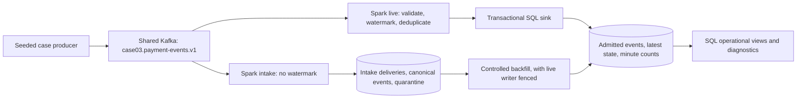

# Milestone 2 streaming design

Status: 12 November 2026. The owner confirmed the decline-rate definition and 10-minute lateness choice. Shared Kafka and optional runtime/intake have passing GitHub checks. The independent watermarked live query, SQL projections, reference refresh and reported-frontier diagnostics are implemented under [decision 0009](decisions/0009-live-state-and-operational-projections.md). [Live evidence](../evidence/stream-live-run.md) records local validation; controlled backfill, forced crash recovery and measurement remain planned.

## Boundary and data flow

The first stream uses a small deterministic fixture and the same payment lifecycle contract as batch. Full-month replay is a later validation profile, not the starting benchmark. Kafka is shared; the producer, Spark job, SQL, checkpoints and `payments_stream` database belong to Case 03. Settlement matching remains in the existing batch SQL.

The intake query preserves what a watermark can exclude. The live query has one stateful operator: watermark-bounded event deduplication. SQL calculates derived state and minute summaries, avoiding a chain of stateful streaming operators. This deliberately demonstrates local Spark event processing, not a distributed production cluster. See [decision 0007](decisions/0007-streaming-correctness-and-recovery.md).

## Event contract v1

Kafka key is the UTF-8 `payment_id`. The value is a versioned JSON envelope: `schema_version=1`, `dataset_id`, delivery-specific `published_at`, and `event`. `event` has exactly the existing source fields: `event_id`, `payment_id`, `merchant_id`, `event_type`, positive integer `sequence_no`, UTC `event_time`, UTC `ingestion_time`, integer `amount_minor` and GBP/EUR/USD `currency`. The producer includes a stable semantic payload hash computed from canonical event fields, excluding delivery metadata.

The first MVP binds one dataset to a streaming database/topic epoch and each query generation. Reject a different dataset on startup; use a separate database/topic lineage for another fixture. This makes event-ID deduplication unambiguous without mixing unrelated seeds or rewriting existing history.

- Event ID is immutable; payment ID plus source sequence identifies one source position. An identical resend is a duplicate. A different payload for either identity is a blocking conflict, never an automatic overwrite. Unknown versions are quarantined with bytes and transport coordinates.
- Preserve source event time and source ingestion time separately from broker append time and sink commit time. Source times are ISO 8601 with an explicit UTC offset. Require event time not later than source ingestion time and constrain both to the declared dataset/replay clock; a corrupt future timestamp must not advance state.
- Validate integer type without coercing decimals or strings; non-null IDs, permitted event type/currency and key/payload agreement are required. Null, malformed, tombstone and wrong-version values retain their original bytes in intake quarantine; live processing excludes them before the watermark.
- Unknown merchants are a reference-data hold, not schema loss. Load the case's seeded reference snapshot independently of a finance pipeline; record its frontier. Later reference arrivals explicitly refresh affected payment histories and minute summaries.
- Per-payment source sequence remains authoritative even though Kafka preserves delivery order within a partition. The planted P2 capture still arrives before its authorisation. Hold the gap; do not invent an authorisation or reorder by timestamp.

Register a topic epoch with its Kafka topic/cluster identity. Topic recreation or checkpoint replacement requires a deliberate new epoch/generation; reused offsets must not collide with prior deliveries. Include that identity in startup checks and evidence. Cross-query conflict detection can lag: until intake and live reach the same validated frontier, outputs are labelled provisional; a conflict makes publication untrusted.

## Proposed grains and keys

Intake, live-ledger, application, latest-state, minute-count, reference and reported-progress tables below are implemented; `ops.stream_backfill` remains planned. Additional implemented control tables register the dataset, role-aware checkpoint lineage, reference snapshot and live conflicts. `generation` separates checkpoint lineages; a restart with the same checkpoint keeps it. Exact DDL is in [intake](../sql/stream/migrations/stream_001_intake.sql) and [live](../sql/stream/migrations/stream_002_live.sql) migrations.

| Table | One row per | Key / behaviour |
| --- | --- | --- |
| `stream.delivery` | Kafka delivery | topic epoch, partition, offset; raw bytes, broker time and intake commit time |
| `stream.intake_event` | Canonical schema-valid source event in a dataset | dataset ID, event ID; unique payment/source sequence, immutable semantic hash and normalised source fields |
| `stream.quarantine` | Rejected delivery and reason | topic epoch, partition, offset, reason; raw bytes retained in the referenced delivery |
| `stream.reference_merchant` | Merchant at the selected reference frontier | merchant ID; separate from finance core writes; snapshot seed/arrival/hash in `stream.reference_snapshot` |
| `stream.live_event` | Canonical event admitted live or by repair | generation, event ID; complete source fields, hash and admission origin |
| `stream.event_application` | Result of applying a live-ledger event | generation, event ID; applied, held, illegal, unknown-reference or identity-mismatch |
| `stream.payment_latest` | Payment state within the live generation | generation, payment ID; source sequence walk, gaps and exact monetary units |
| `stream.event_minute` | Merchant/currency/event type/application outcome in a UTC minute | generation, minute start, merchant ID, currency, event type, outcome; replace derived counts |
| `ops.stream_batch` | Committed database sink batch | generation, query role, batch ID; counts and commit time; intake hashes physical input, live hashes admitted semantic events |
| `ops.stream_progress` | Reported Spark query progress | generation, query role, batch ID; offsets, watermark and state metrics; not a transaction spanning both queries |
| `ops.stream_backfill` | Controlled repair | repair ID; input/reference frontier, scope, status, before/after counts and reason |

Do not mix generations in one operational view. Minute buckets are half-open UTC `[start, start + 1 minute)`. Definitions and eligibility are owned by [metrics](metrics.md); event counts are not snapshots of current payment status.

## Commit, ordering and duplicate rules

Each `foreachBatch` consumes its entire bounded output, including a repeated batch whose database effects are already committed. For this laptop MVP, stream rows through the driver into a PostgreSQL staging/COPY transaction, rather than independent executor commits. Set a micro-batch input cap; this is an explicit local bottleneck and must not be presented as a scalable sink benchmark.

Within each query transaction: verify generation and immutable hashes, insert unseen delivery/event keys, refresh affected SQL projections, then record the batch commit. Rollback on failure. On retry, return the same database effects. A database advisory lock fences a second live writer for that generation. Progress callbacks may lag commits; do not treat a progress row alone as financial completeness.

The existing SQL transition values and sequence walk are shared through explicit relative SQL includes in `sql/shared/`, resolved by the CLI. Batch retains its independent Python replay tests. Live rewalks the complete history of affected payments and refreshes every touched minute, aggregating all neighbouring payments in those buckets. Independent reference refresh atomically reprojects all live generations while fencing live writes. Foreign currency amounts are never added together, and no matching logic moves into Python or Spark floating-point expressions.

## Event time, checkpoints and recovery

- Owner-confirmed watermark delay: **10 minutes** on `event_time`. Event ID is the Spark deduplication key. PostgreSQL uniqueness remains the final duplicate guard after Spark state eviction.
- Use independent persistent checkpoint directories for `intake-v1` and `live-v1`. Start at earliest available offsets for a new lineage; resume offsets from the existing checkpoint on restart. Keep `failOnDataLoss=true`. Use separate case/query `groupIdPrefix` values, not a shared forced Kafka group ID.
- State is evicted only as observed event time advances; an idle query has no wall-clock expiry guarantee. Record state rows/memory and the actual watermark. A watermark bounds a time range under an input rate; it is not an absolute RAM limit.
- Beyond-watermark admission is not a deterministic age cutoff. Monitor Spark's actual late-drop metrics separately from source ingestion lag; do not label every record with source lag over ten minutes as a proven Spark drop. Intake contains the full source ledger regardless of the live query's decision.
- Backfill: stop/fence live writes; wait for intake to reach an explicit partition-offset and reference frontier; select valid missing events; rewalk complete affected payment histories and replace affected minute counts in one transaction; record the repair; resume the same live checkpoint. For the first small fixture, a full-generation rebuild is acceptable. Retain admitted/backfilled event keys so later re-delivery cannot count them again.
- Prove parity against the batch reference at the same dataset, source-clock cutoff and reference version after repair. Compare payment state/business columns and independently derived minute counts. Expected live incompleteness before repair is visible; it is not unexplained financial reconciliation loss.
- Lost/expired Kafka offsets fail visibly. Recover from retained intake/source fixtures with a new checkpoint generation; never silently reset to latest. Retain fixture/audit history for this bounded MVP. Database archival and backup guarantees are not implemented by the watermark or broker retention.

Spark's [Kafka guide](https://spark.apache.org/docs/4.2.1/streaming/structured-streaming-kafka-integration.html) describes checkpoint-based source progress, generated groups and data-loss behaviour. The [streaming guide](https://spark.apache.org/docs/4.2.1/streaming/apis-on-dataframes-and-datasets.html) explains watermark and sink semantics. The implementation must still prove this specific recovery design.

## Replay profiles and measurement

The existing seed-3303 source profile has ordinary source delays no greater than 90 seconds and exactly one delay over ten minutes: P2's authorisation at 86,400 seconds. These are source-clock delays, not measured Kafka/Spark latency; see [design checks](../evidence/streaming-design-checks.md).

Start with a short, named deterministic stream fixture containing normal events, same-batch/cross-batch duplicates, out-of-order sequences, malformed data and one very late event. Publish phases in source ingestion order and wait for both queries' target offset frontiers before advancing to a phase that moves the watermark. Include valid later events to demonstrate eviction; an empty batch or sleep alone does not advance event time. Track partition skew and avoid attributing artificial fast-replay skew to business lateness.

Full-month replay is separately labelled accelerated historical replay. It cannot establish real-time event latency from old timestamps. A later paced/current-clock fixture may measure event-to-sink latency; always also report broker-append-to-sink latency, input/output rate, backlog, hardware and repeats. Initial engineering target: five-second triggers and p95 broker-to-sink under 15 seconds at the declared small load; this is unmeasured.

## Runtime candidates and memory

Kafka `4.3.2` is pinned and verified in the shared foundation. The optional image now pins PySpark and matching Scala-2.13 Kafka connector `4.2.1`, Python `3.12.16` and producer `confluent-kafka 2.16.1`; it installs OpenJDK `21` (actual patch in [runtime evidence](../evidence/stream-intake-run.md)). Actual producer/Spark intake compatibility passed. Spark's connector retains `kafka-clients 3.9.2`; do not override it merely to match the broker number. Python dependencies are locked; the JRE patch and Maven transitives are not digest-locked. Original metadata checks are in [design checks](../evidence/streaming-design-checks.md).

Streaming dependencies use an opt-in case group/image; the batch image and shared Airflow environment need no PySpark or JRE. Initial implemented limits: Kafka 512 MiB heap within a 1.5 GiB container; Spark `local[2]`, three shuffle partitions, 1 GiB driver heap within a 3 GiB container; 3,000 input offsets per micro-batch and sink rejection over 5,000 rows or 16 MiB of key/value bytes. These are local processing budgets, not hard bounds on all Spark/driver allocations. PostgreSQL and OS/native overhead need headroom. Docker currently has 8 logical CPUs and 8,225,247,232 bytes (~7.66 GiB); the physical laptop remains four cores. Keep Airflow stopped during streaming checks. No peak-memory benchmark has been run.

## Delivery slices and acceptance evidence

1. **Shared broker foundation — local and GitHub checks passed:** optional network/listeners, persistent volume, case-owned idempotent topic creation; listener roundtrips, native host metadata, restart and unrelated-topic preservation. See foundation evidence for the exact client paths.
2. **Runtime/intake — local and GitHub checks passed:** optional Python/JRE/Spark/connector runtime; acknowledged versioned fixture; deliveries and quarantine without a watermark. Actual checkpoint restart/re-publication passed; database tests cover hash conflicts, rollback and lineage guards.
3. **Live slice — implemented:** independent role/checkpoint, bounded deduplication, SQL latest/minute projections and operational views, reference refresh and reported-frontier status. [Live evidence](../evidence/stream-live-run.md) owns duplicate/restart (A9), batch-state parity and actual watermark checks. Decline rate and expiries remain separate.
4. **Recovery slice:** crash before/after sink commit; verify checkpoint continuation and no accepted-event loss (A10); repair a deliberately beyond-watermark record and prove parity (A11); advance event time over repeated intervals and observe eviction (A12). Expose live/intake frontier mismatch rather than claiming atomicity.
5. **Measurement:** only after correctness, run bounded, repeatable latency/throughput profiles. No cloud, Databricks, Kubernetes, schema registry or extra application framework is required.

Metric and lateness choices are confirmed. No further business answer blocks controlled recovery. Keep implemented intake/live guarantees separate from the remaining crash, late-backfill, sustained eviction and measurement work.
