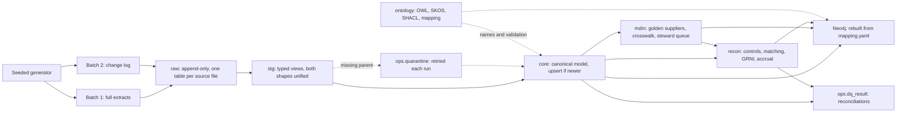

# Agentic procure-to-pay reconciliation

**Status: building. Milestone 1 (deterministic core) works end to end locally; agents, embeddings and security are not built yet.** All data is synthetic. Specialist case.

Built: PostgreSQL with pgvector (the extension is installed; vectors arrive in milestone 2), OWL/SKOS/SHACL ontology (rdflib, pySHACL), Neo4j projection, seeded generator, incremental ingestion, supplier entity resolution, SQL matching engine, data-quality checks and reconciliations.

## Business problem

A fictional consumer-goods group runs two ERPs: an "SAP-like" system for its UK company and an "Oracle-like" system for its German company. Finance needs assurance over the whole procure-to-pay chain:

**Purchase requisition → approval → purchase order → goods received notes → supplier invoices → payment readiness.**

Accounts payable and controllers need every invoice checked against what was requested, approved, ordered and received, with exceptions explained and evidenced. In the target design agents do the investigation work and finance users stay in control. This milestone builds the deterministic layer they will depend on: every status and every amount below comes from SQL, not from a model.

## Why this case exists

It answers one design question: what does a trustworthy finance data layer for agents look like? It combines a finance ontology, a governed relational model, a rebuildable knowledge graph and, from milestone 2, permission-aware retrieval.

## Run it

Needs Windows 11 with Docker Desktop and [uv](https://docs.astral.sh/uv/) on the PATH. All commands are PowerShell, from this folder, and were run as written on 30 October 2026.

```powershell
Copy-Item .env.example .env        # local-only passwords; change them if you wish
docker compose -f infra/docker-compose.yml --env-file .env up -d --wait
uv sync
uv run p2p run-all                 # generate, then both batches through every step, then the graph
uv run p2p status                  # statuses, exceptions, GRNI, quarantine, data quality
uv run pytest                      # uses a separate p2p_test database
```

Every step also runs alone: `uv run p2p --help`. See the [runbook](docs/runbook.md) for each command, failure handling and clean-up.

Look at the results in Neo4j Browser at <http://127.0.0.1:7474>, or through the Cypher library:

```powershell
uv run p2p graph-query supplier_duplicates
uv run p2p graph-query chain_gaps
```

## What happens in a run



The difficult logic, in the order worth reading:

- [sql/routines/30_recon.sql](sql/routines/30_recon.sql): the matching engine. Controls, tolerances as of the invoice date, cumulative quantities, duplicates through the golden supplier, GRNI and the accrual.
- [src/p2p_recon/conform.py](src/p2p_recon/conform.py): watermark with lookback, latest version per key, quarantine and retry, upsert if newer.
- [src/p2p_recon/mdm.py](src/p2p_recon/mdm.py): when VAT, bank and name evidence may merge suppliers, and when they must not.
- [src/p2p_recon/dq.py](src/p2p_recon/dq.py): control totals computed from raw independently of the staging views.
- [ontology/mapping.yaml](ontology/mapping.yaml): one allowlist that drives both the Neo4j and the RDF projection.
- [docs/decisions](docs/decisions/README.md): the reasoning, including what would be simpler.

## Results

Measured on 30 October 2026 with seed 6042; full record in [evidence](evidence/milestone-1-run.md). These numbers describe synthetic data planted to behave this way, not any real business.

| Check | Result |
| --- | --- |
| Planted scenarios reaching their exact expected status and reason codes | 36 of 36 (S01–S36) |
| Exceptions outside the planted scenarios (false positives) | 0, across the background invoice lines |
| Tests | 67 passed |
| Rule mutations caught when a rule is deliberately broken | 20 of 20 (9 of 12 on the first attempt; the gaps became new scenarios) |
| Rerun with nothing new delivered | 0 rows landed, 0 core rows written, identical results |
| Data-quality checks and reconciliations after both batches | 36 pass, 0 warn, 0 fail |
| Graph against PostgreSQL | 3,395 nodes and 6,862 edges, no count differences |
| Supplier resolution | 60 source records → 56 golden; 3 pairs in the steward queue |

Volumes: 2 companies, 60 suppliers, 400 requisitions, 317 purchase orders, 326 receipt lines, 307 invoices and credit notes, 360 invoice lines.

## Known limitations

- **Not built yet:** embeddings and retrieval, agents, row-level security and masking, data contracts, CI. Bank numbers are unmasked in `core`; they are only kept out of the graph. Generated documents are not yet loaded anywhere.
- **Local prototype.** One machine, simulated CDC from files. No real ERP extraction, no deployment, no delivery guarantee beyond what the tests show.
- **Modelling simplifications:** one line per requisition, one shared item master, net amounts with no tax, one primary supplier site, no return receipts (so a valid credit note raises GRNI until a return is posted), one flat FX rate per period. The contract supplies tolerance only: PO price is not checked against the contract's agreed price.
- **GRNI is on document dates, not knowledge time.** Re-running a past cut-off after a late correction gives the corrected position, not what was known at the time. Snapshots per run preserve the earlier answer, but this is not bitemporal.
- **A malformed value fails the whole conform run** instead of quarantining the row. Only missing references quarantine.
- **SHACL validates sampled chains from the real tables, not every row.**
- Timings here are single runs on a laptop and are not benchmarks.

## Documentation

[Requirements](docs/requirements.md) · [Architecture](docs/architecture.md) · [Data model](docs/data-model.md) · [Scenarios](docs/scenarios.md) · [Metrics](docs/metrics.md) · [Agent design (milestone 2)](docs/agent-design.md) · [Ontology](ontology/README.md) · [Decisions](docs/decisions/README.md) · [Runbook](docs/runbook.md) · [Evidence](evidence/README.md)

[Return to portfolio](../../README.md).
