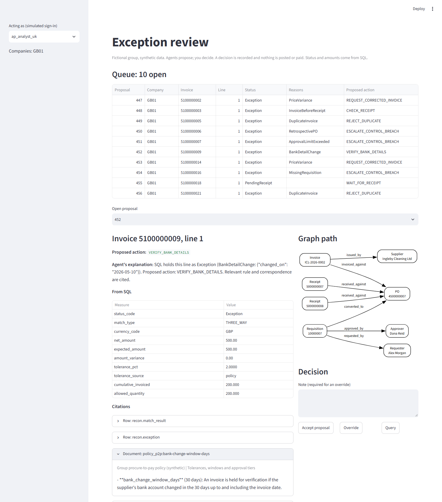
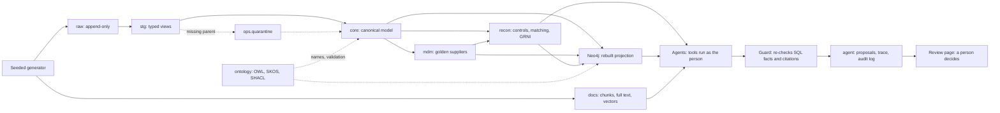

# Agentic procure-to-pay reconciliation

**Status: built and validated locally on synthetic data. Agents have been evaluated with an offline rule-based provider only, not a live model. CI is written and rehearsed but has not yet run on GitHub. Nothing is deployed.**

A fictional group with two ERPs needs every supplier invoice checked against what was requested, approved, ordered and received. SQL does the accounting; agents investigate exceptions and cite their evidence; a person decides, and the database enforces who may see and do what.

Reading depth: this page, then the [five-minute walkthrough](docs/walkthrough.md), then the code paths below. Stack: PostgreSQL with pgvector, Neo4j, OWL/SKOS/SHACL (rdflib, pySHACL), LangGraph, fastembed, Streamlit, Python, SQL. No API key is needed on the default path.



## 1. Problem and decision

Accounts payable and controllers at a consumer-goods group run an "SAP-like" ERP in the UK and an "Oracle-like" ERP in Germany. Suppliers have different identifiers in each, approval rules are applied differently, and exceptions are explained in email.

| Who | Decision | What they need |
| --- | --- | --- |
| Accounts payable analyst | Release, query or reject a held invoice | Why it is held, with the rule and correspondence |
| Financial controller | Clear a failed control; approve the month-end accrual | Control evidence; goods received not invoiced |
| Internal auditor | Is the control working? | A trail from any decision to its source rows |

The design question: **what does a finance data layer have to be for agents to work on it safely?**

## 2. Scope and success

**In scope:** two ERP-shaped sources; incremental ingestion; supplier resolution; matching and controls; GRNI and a proposed accrual; ontology; graph; retrieval; agents; review; security; contracts; lineage.

**Out of scope:** real ERP connections, payment execution, OCR, production identity management, cloud hosting.

**Correct means:** every planted scenario reaches its exact expected status and reasons; no exception appears outside them; a rerun changes nothing; a late correction changes only what it affects; no agent can approve a held line, read another company's data or change the books. Results are in section 9.

## 3. Data

All synthetic, from a seeded generator: same seed, same bytes. No employer data. Details: [data README](data/README.md).

| | |
| --- | --- |
| Volumes | 2 companies, 60 suppliers, 400 requisitions, 317 purchase orders, 326 receipt lines, 307 invoices and credit notes, 360 invoice lines, 84 documents, 238 chunks |
| Shapes | SAP-like: semicolons, `YYYYMMDD`, padded ids, positive credit notes. Oracle-like: commas, `DD-MON-YYYY`, negative credit notes |
| Updates | Batch 1 is full extracts. Batch 2 is a simulated change log, with late corrections, deletes and an out-of-order row |
| Defects | [36 planted scenarios](docs/scenarios.md): duplicates, late reference data, split requisitions, over-limit and self-approvals, recent bank changes, currency mismatches. The rest is clean by construction, so any other exception is a false positive |
| Documents | A policy, local procedures, audit memos, near-identical contracts, supplier email (one with a prompt injection) and routine distractor mail |

## 4. Architecture



PostgreSQL is the only source of truth; Neo4j and embeddings are rebuildable. This runs on one machine in Docker. A production design would read from ERP extraction services and use enterprise identity and monitoring, and none of that is claimed here. More: [architecture](docs/architecture.md), [agent design](docs/agent-design.md), [security](docs/security.md).

## 5. Modelling

Every table declares its grain and keys: [data model](docs/data-model.md). Money is `NUMERIC` with a currency, and is never totalled across currencies without a rate.

- **History:** versioned employee limits and contracts, so a control uses the limit in force at the time. Results are snapshots per run, read through `current_*` views.
- **Ontology:** OWL classes and SKOS reason codes, mapped to tables through one allowlist that drives both the graph and the RDF export. SHACL validates real chains.
- **Contracts:** [versioned YAML](contracts/README.md) for supplier, purchase order, invoice and match result.
- **Metrics:** definitions in [the catalogue](docs/metrics.md).

## 6. Implementation

The difficult logic, in the order worth reading:

| Path | Why read it |
| --- | --- |
| [sql/routines/30_recon.sql](sql/routines/30_recon.sql) | The matching engine: controls, tolerances as of the invoice date, cumulative quantities, duplicates through the golden supplier, GRNI |
| [sql/migrations/006_security.sql](sql/migrations/006_security.sql) | Roles, row-level security, decision rights and the audit log |
| [src/p2p_recon/agents/guard.py](src/p2p_recon/agents/guard.py) | Why a misbehaving model cannot produce a false approval |
| [src/p2p_recon/agents/tools.py](src/p2p_recon/agents/tools.py) | How a tool runs as the person it acts for |
| [src/p2p_recon/retrieval.py](src/p2p_recon/retrieval.py) | Permissions before ranking, rank fusion, how the graph picks documents |
| [src/p2p_recon/conform.py](src/p2p_recon/conform.py) | Watermark with lookback, quarantine and retry, upsert if newer |
| [src/p2p_recon/mdm.py](src/p2p_recon/mdm.py) | When evidence may merge suppliers, and when it must not |
| [src/p2p_recon/contracts.py](src/p2p_recon/contracts.py) | What counts as a breaking change |
| [sql/migrations/007_admin_review.sql](sql/migrations/007_admin_review.sql) | A reviewer who sees everything and decides nothing, added through the visibility functions instead of copied policies |
| [src/p2p_recon/admin/rules.py](src/p2p_recon/admin/rules.py) | Rules, workflow, guard and decision rights read from what applies them, with tests that fail on drift |
| [docs/decisions](docs/decisions/README.md) | The reasoning, including where something simpler would do |

### Run it

Needs Docker Desktop and [uv](https://docs.astral.sh/uv/). PowerShell, from this folder, run as written on Windows 11 on 2 November 2026. The first run downloads a 64 MB embedding model.

```powershell
Copy-Item .env.example .env        # local-only passwords; change them if you wish
docker compose -f infra/docker-compose.yml --env-file .env up -d --wait
uv sync
uv run p2p run-all                 # generate, both batches through every step, documents, the graph
uv run p2p agent-run --as ap_analyst_uk
uv run streamlit run src/p2p_recon/review_app.py --server.address 127.0.0.1
uv run p2p trace <proposal_id>     # from a proposal back to source files
uv run p2p contracts-check
uv run p2p access-probe            # each role against what it may and may not do, recorded
uv run streamlit run src/p2p_recon/admin_app.py --server.address 127.0.0.1   # governance review
uv run pytest
```

Every command, failure and recovery: [runbook](docs/runbook.md).

## 7. Reliability

- **Runs:** every step records status, counts and lineage edges in `ops`. A failed step rolls back and stays recorded as failed.
- **Quality gates:** 36 data-quality checks and control totals computed from `raw` independently of the staging views.
- **Injected failures, with tests:** a truncated, corrupted or drifted delivery fails atomically and leaves nothing to clean up. A row the watermark misses fails a reconciliation. A late correction changes only the affected results. A model outage sends the line to a person.
- **Rerun safety:** repeating every step with nothing new lands no rows, writes no core rows and gives identical results.
- **Change control:** a breaking change to a data contract fails tests without a new major version. A catalogue test fails if a new company table or view lacks row-level protection.
- **CI:** [a workflow](../../.github/workflows/case-06-ci.yml) limited to this case runs lint, SHACL, the pipeline, contracts, the offline evaluation and all tests against service containers. The same steps passed in a Linux container locally. **It has not yet run on GitHub.**

## 8. Business consumption

- **[Review page](src/p2p_recon/review_app.py):** the queue, the agent's explanation, the SQL figures, each citation and the graph path, then accept, override or query. [What each role sees](evidence/screenshots/). Nothing is posted or paid.
- **[Governance admin app](src/p2p_recon/admin_app.py):** for a read-only `admin_reviewer` who sees both companies and decides nothing ([decision 0010](docs/decisions/0010-admin-review-dashboard.md)).
  - **Agents:** behaviour, including agreement with people, guard interventions and citation validity, with a drill-down to one run's steps, tool calls and trace.
  - **Evaluations:** stored scenario, hostile, outage, access and retrieval results.
  - **Entities and relationships:** graph neighbourhoods and supplier resolution.
  - **Ontology:** coverage, drift and the impact of changing a term.
  - **Lineage and contracts:** dataset lineage, and each contract against its release.
  - **Access and audit:** a permission matrix read from the catalogue, the audit log, and review notes.
  - **How the agents decide:** rules, workflow, guard and decision rights.
  - **Audit packs:** markdown or CSV per proposal or date range. [Screenshots](evidence/screenshots/).
- **[Trace](evidence/trace-S14.md):** one proposal back through tool calls, citations and core rows to the delivered file, row and checksum.
- **`p2p status`:** statuses, exceptions by reason, value on hold per currency, GRNI, quarantine.
- **Decisions enabled:** which invoices to release or query, which failed controls need the controller, and the month-end accrual to review. In this synthetic population, 22 of 360 lines are held.

## 9. Results

Measured on 2 November 2026, seed 6042, one laptop, from empty Docker volumes. Full record: [milestone 3](evidence/milestone-3-run.md), [milestone 2](evidence/milestone-2-run.md), [milestone 1](evidence/milestone-1-run.md). **These describe synthetic data planted to behave this way, not any real business, and timings are single runs.**

### Deterministic core

| Check | Result |
| --- | --- |
| Planted scenarios reaching their exact status and reasons | 36 of 36 |
| Exceptions outside the planted scenarios | 0 |
| Data-quality checks and reconciliations | 36 pass, 0 warn, 0 fail |
| Rerun with nothing new delivered | 0 rows landed, 0 core rows written |
| Graph against PostgreSQL | 3,419 nodes and 6,862 edges, no differences |
| Supplier resolution | 60 records → 56 golden; 3 pairs for a steward |
| Tests | 368 passed, on Windows and in a Linux container |
| Rules deliberately broken and caught | Core 20 of 20; retrieval and agents 25 of 25; security, contracts and review 31 of 31 |

### Retrieval

36 hand-labelled questions, written by the corpus's author, with nothing tuned against them, so indicative only ([report](evidence/retrieval-evaluation.md)).

| Method | Recall@1 | Recall@3 | Recall@5 | MRR |
| --- | --- | --- | --- | --- |
| Keyword | 39% | 58% | 67% | 0.509 |
| Vector | 50% | 69% | 78% | 0.622 |
| Hybrid | 44% | 67% | 72% | 0.591 |
| Hybrid plus graph | 56% | 81% | 83% | 0.705 |

Hybrid did **not** beat vector here: on near-identical contract clauses, keywords add more noise than signal. The graph's gain is almost all on questions about "this invoice" that name no supplier, where recall@5 goes from 50% to 100%.

### Agents, offline provider

**The offline provider is a rule table, so these show that the pipeline and guardrails work, not that a model has good judgement.** Cost is zero because no model was called ([report](evidence/agent-evaluation-offline.md)).

| Check | Result |
| --- | --- |
| Status and reasons agree on 42 planted lines (read from SQL) | 100% |
| Proposed action agrees with hand-written labels | 100% |
| Citations that resolve and the user may read | 100% |
| False auto-approvals: planted lines; all 360 lines | 0; 0 |
| False auto-approvals from a hostile provider | 0, from 13 attempts on 22 held lines |
| Held lines when the provider is down | 22 of 22 go to a person |
| Requests for another company's lines | 42 of 42 denied |
| Wall-clock per invoice, no model time | 0.24 s median, 0.31 s p95 |

### Security

Allowed and denied tests for every role, through a real unprivileged login: [security](docs/security.md). Row-level security holds with the application's own filter removed, and application filters hold on a login that bypasses row-level security.

### Governance review

Measured on 3 November 2026 after `p2p reset --yes` and `run-all`, offline provider. Full record: [governance review run](evidence/governance-review-run.md).

| Check | Result |
| --- | --- |
| Access probe: each role against the contracts' promises and the fixed rules | 83 of 83 attempts behaved as expected |
| Decision rights shown, against what PostgreSQL accepts | Every role, decision, proposal kind and lifecycle state agrees |
| Rules, workflow drawing and guard catalogue against their sources | Agree; tests fail on any drift |
| Sampled real chains conforming to SHACL | 25 of 25, after fixing a defect that rejected every real reason code |
| Admin pages rendering for the reviewer; refusing an analyst and the auditor | 8 of 8; all refuse |
| Rules deliberately broken and caught | 18 of 18 (role); 18 of 18, 21 of 21 and 18 of 18 (pages) |
| Tests | 550 passed on Windows; ruff clean |

## 10. Trade-offs and next step

- **Neo4j is not strictly needed.** SQL would serve every chain check here, and the graph's measured value is narrow. [Decision 0001](docs/decisions/0001-graph-store.md) says so.
- **LangGraph is not strictly needed either.** A plain state machine would do, without the dependency tree ([0008](docs/decisions/0008-agent-orchestration.md)).
- **An exact vector scan** is right at 238 chunks and wrong at millions ([0007](docs/decisions/0007-retrieval.md)).
- **Full recompute per run** is simple and safe, and would not scale ([0005](docs/decisions/0005-recompute-and-snapshots.md)).

### Known limitations

- **No live model has been evaluated.** `anthropic` and `ollama` have run against mocks only. Judgement, real tokens, real cost and prompt injection against a real model are all unmeasured.
- **Sign-in is simulated.** One login assumes roles, and the page's selector picks one. The pipeline login is a superuser.
- **Neo4j has no row-level security** in Community Edition, so its company filter is in the query, and anyone with its password can see the whole graph.
- **Local prototype.** One machine, simulated CDC from files, no delivery guarantee beyond what the tests show.
- **No finance professional has reviewed the rules.** The freshness SLA and retention periods are proposals. SOX-style checks are not a SOX programme.
- **Modelling simplifications:** one line per requisition, one shared item master, net amounts with no tax, one primary supplier site, no return receipts (so a valid credit note raises GRNI until a return is posted), one flat FX rate per period, and tolerance only from contracts: PO price is not checked against the agreed price.
- **GRNI is on document dates, not knowledge time.** Snapshots keep earlier answers, but this is not bitemporal.
- **A malformed value fails the whole conform run** instead of quarantining the row. SHACL validates sampled chains, not every row. The ontology does not yet cover proposed actions.

**Next step:** one evaluation against a live model on the same planted scenarios. It is the only thing that can show whether the explanations would save a clerk any time.

## Documentation

[Walkthrough](docs/walkthrough.md) · [Requirements](docs/requirements.md) · [Architecture](docs/architecture.md) · [Data model](docs/data-model.md) · [Scenarios](docs/scenarios.md) · [Metrics](docs/metrics.md) · [Agent design](docs/agent-design.md) · [Security](docs/security.md) · [Contracts](contracts/README.md) · [Ontology](ontology/README.md) · [Decisions](docs/decisions/README.md) · [Runbook](docs/runbook.md) · [Evidence](evidence/README.md)

[Return to portfolio](../../README.md).
