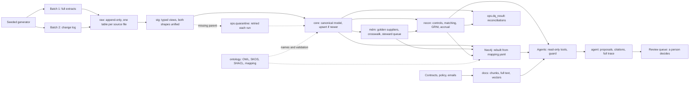

# Agentic procure-to-pay reconciliation

**Status: building. Milestones 1 (deterministic core) and 2 (retrieval and agents) work end to end locally. Agents have been evaluated with an offline rule-based provider only, not a live model. Row-level security, data contracts and CI are not built.** All data is synthetic. Specialist case.

Built: PostgreSQL with pgvector, OWL/SKOS/SHACL ontology (rdflib, pySHACL), Neo4j projection, seeded generator, incremental ingestion, supplier entity resolution, SQL matching engine, data-quality checks and reconciliations, local embeddings (fastembed), permission-aware hybrid and graph retrieval, a LangGraph agent workflow with a guard, a human review queue, and retrieval and agent evaluation.

## Business problem

A fictional consumer-goods group runs two ERPs: an "SAP-like" system for its UK company and an "Oracle-like" system for its German company. Finance needs assurance over the whole procure-to-pay chain:

**Purchase requisition → approval → purchase order → goods received notes → supplier invoices → payment readiness.**

Accounts payable and controllers need every invoice checked against what was requested, approved, ordered and received, with exceptions explained and evidenced. Agents do the investigation work and finance users stay in control. Every status and every amount comes from SQL, not from a model. Agents read through tools, cite their evidence and write proposals; they cannot post, pay or change a status.

## Why this case exists

It answers one design question: what does a trustworthy finance data layer for agents look like? It combines a finance ontology, a governed relational model, a rebuildable knowledge graph and permission-aware retrieval.

## Run it

Needs Windows 11 with Docker Desktop and [uv](https://docs.astral.sh/uv/) on the PATH. No API key is needed. All commands are PowerShell, from this folder, and were run as written on 2 November 2026. The first run downloads a 64 MB embedding model.

```powershell
Copy-Item .env.example .env        # local-only passwords; change them if you wish
docker compose -f infra/docker-compose.yml --env-file .env up -d --wait
uv sync
uv run p2p run-all                 # generate, both batches through every step, documents, then the graph
uv run p2p status                  # statuses, exceptions, GRNI, quarantine, data quality
uv run p2p agent-run --as ap_gb01  # investigate GB01's held lines with the offline provider
uv run p2p review-list --as ap_gb01  # the proposals waiting for a person
uv run p2p eval-retrieval          # recall@k and MRR, written to evidence/
uv run p2p agent-eval              # the planted scenarios through the agents, written to evidence/
uv run pytest                      # uses a separate p2p_test database
```

Every step also runs alone: `uv run p2p --help`. See the [runbook](docs/runbook.md) for each command, failure handling and clean-up.

Look at the results in Neo4j Browser at <http://127.0.0.1:7474>, or through the Cypher library:

```powershell
uv run p2p graph-query supplier_duplicates
uv run p2p graph-query chain_gaps
```

## What happens in a run



The difficult logic, in the order worth reading:

- [sql/routines/30_recon.sql](sql/routines/30_recon.sql): the matching engine. Controls, tolerances as of the invoice date, cumulative quantities, duplicates through the golden supplier, GRNI and the accrual.
- [src/p2p_recon/conform.py](src/p2p_recon/conform.py): watermark with lookback, latest version per key, quarantine and retry, upsert if newer.
- [src/p2p_recon/mdm.py](src/p2p_recon/mdm.py): when VAT, bank and name evidence may merge suppliers, and when they must not.
- [src/p2p_recon/dq.py](src/p2p_recon/dq.py): control totals computed from raw independently of the staging views.
- [ontology/mapping.yaml](ontology/mapping.yaml): one allowlist that drives both the Neo4j and the RDF projection.
- [src/p2p_recon/agents/guard.py](src/p2p_recon/agents/guard.py): why a misbehaving model cannot produce a false approval.
- [src/p2p_recon/retrieval.py](src/p2p_recon/retrieval.py): permissions before ranking, fusion, and how the graph picks documents.
- [sql/routines/40_agent.sql](sql/routines/40_agent.sql): what the agents' database role can and cannot touch.
- [docs/decisions](docs/decisions/README.md): the reasoning, including what would be simpler.

## Results

Measured on 2 November 2026 with seed 6042; full record in [evidence](evidence/milestone-2-run.md), with [milestone 1 here](evidence/milestone-1-run.md). These numbers describe synthetic data planted to behave this way, not any real business.

| Check | Result |
| --- | --- |
| Planted scenarios reaching their exact expected status and reason codes | 36 of 36 (S01–S36) |
| Exceptions outside the planted scenarios (false positives) | 0, across the background invoice lines |
| Tests | 162 passed |
| Rule mutations caught when a rule is deliberately broken | Core: 20 of 20. Retrieval and agents: 25 of 25 (24 on the first pass; the gap became a test) |
| Rerun with nothing new delivered | 0 rows landed, 0 core rows written, identical results |
| Data-quality checks and reconciliations after both batches | 36 pass, 0 warn, 0 fail |
| Graph against PostgreSQL | 3,419 nodes and 6,862 edges, no count differences |
| Supplier resolution | 60 source records → 56 golden; 3 pairs in the steward queue |

Volumes: 2 companies, 60 suppliers, 400 requisitions, 317 purchase orders, 326 receipt lines, 307 invoices and credit notes, 360 invoice lines, 84 documents, 238 chunks.

### Retrieval

36 hand-labelled questions ([report](evidence/retrieval-evaluation.md)). Indicative only: a small set, from the corpus's author, with nothing tuned against it.

| Method | Recall@1 | Recall@3 | Recall@5 | MRR |
| --- | --- | --- | --- | --- |
| Keyword | 39% | 58% | 67% | 0.509 |
| Vector | 50% | 69% | 78% | 0.622 |
| Hybrid | 44% | 67% | 72% | 0.591 |
| Hybrid plus graph | 56% | 81% | 83% | 0.705 |

Hybrid search did **not** beat vector search here: on near-identical contract clauses, ORed keywords add more noise than signal. The graph's gain is almost all on questions about "this invoice" that name no supplier, where recall@5 goes from 50% to 100%. [Decision 0007](docs/decisions/0007-retrieval.md) has the reasoning.

### Agents, with the offline provider

[Report](evidence/agent-evaluation-offline.md). **The offline provider is a rule table, so these figures show the pipeline and guardrails work, not that a model has good judgement.** No live model has been evaluated, and cost is zero because none was called.

| Check | Result |
| --- | --- |
| Planted invoice lines | 42 |
| Status and reasons agree with expected outcomes (read from SQL) | 100% |
| Proposed action agrees with hand-written labels | 100% |
| Citations that resolve and the user may read | 100% |
| False auto-approvals: planted lines, all 360 lines | 0, 0 |
| False auto-approvals from a hostile provider | 0, from 13 attempts on 22 held lines |
| Held lines when the provider is down | 22 of 22 go to a person |
| Requests for the other company's lines | 42 of 42 denied |
| Wall-clock per invoice, excluding any model time | 0.24 s median, 0.34 s p95 |

## Known limitations

- **No live model has been evaluated.** The `anthropic` and `ollama` providers have only run against mocked responses. Agent judgement, real token counts, real cost and resistance to prompt injection in an actual model are all unmeasured.
- **Not built yet:** row-level security and masking, data contracts, a review interface beyond the CLI, lineage trace as a command, CI. Company scoping is application code. Bank numbers are unmasked in `core`, though the agents' role and the graph cannot read them.
- **Only the investigator uses a model,** and it can only search documents and draft a proposal. Controls and matching agents are deterministic by design.
- **Retrieval uses an English model and an exact scan.** German text would need a multilingual model, and much larger volumes an approximate index whose recall under the permission filter was measured.
- **Local prototype.** One machine, simulated CDC from files. No real ERP extraction, no deployment, no delivery guarantee beyond what the tests show.
- **Modelling simplifications:** one line per requisition, one shared item master, net amounts with no tax, one primary supplier site, no return receipts (so a valid credit note raises GRNI until a return is posted), one flat FX rate per period. The contract supplies tolerance only: PO price is not checked against the contract's agreed price.
- **GRNI is on document dates, not knowledge time.** Re-running a past cut-off after a late correction gives the corrected position, not what was known at the time. Snapshots per run preserve the earlier answer, but this is not bitemporal.
- **A malformed value fails the whole conform run** instead of quarantining the row. Only missing references quarantine.
- **SHACL validates sampled chains from the real tables, not every row.**
- Timings here are single runs on a laptop and are not benchmarks.

## Documentation

[Requirements](docs/requirements.md) · [Architecture](docs/architecture.md) · [Data model](docs/data-model.md) · [Scenarios](docs/scenarios.md) · [Metrics](docs/metrics.md) · [Agent design](docs/agent-design.md) · [Ontology](ontology/README.md) · [Decisions](docs/decisions/README.md) · [Runbook](docs/runbook.md) · [Evidence](evidence/README.md)

[Return to portfolio](../../README.md).
