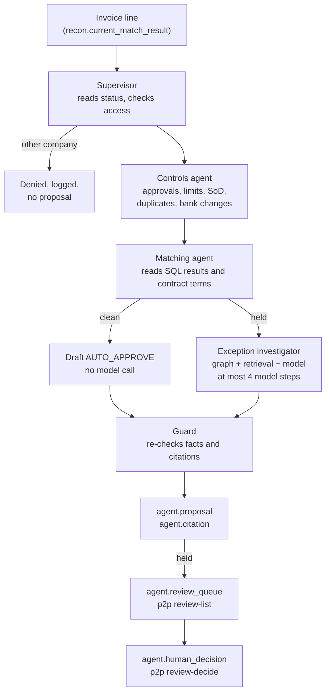

# Agent design

Status: built and evaluated with the offline provider, and acting under each person's database role since milestone 3. Live providers have been tested against mocked responses only. See [decision 0008](decisions/0008-agent-orchestration.md) and [the evaluation](../evidence/agent-evaluation-offline.md).

## Principle

Agents investigate and propose. Deterministic SQL computes matches, tolerances and amounts. Finance users decide. Every step is logged and traceable to source rows and cited document chunks.

## Agents

| Agent | Purpose | Tools (read-only) | Calls a model? | Output |
| --- | --- | --- | --- | --- |
| Supervisor | Routes each line and refuses what the user may not see | `read_queue_item` | No | Status and reasons, or a denial |
| Controls agent | Control findings and the requisition breaches behind them | `check_controls` | No | Findings with row citations |
| Matching agent | SQL result and governing contract version. Never computes an amount | `get_match_result`, `get_contract_terms` | No | Variances with row citations |
| Exception investigator | Explains the cause and proposes an action with evidence | `get_document_chain`, `search_documents` | Yes | Draft proposal |
| Guard | Decides what may be stored, from SQL facts and the run's own tool results | None | No | Proposal and flags |

`search_documents` runs two searches: the rules that apply (policy and procedure, hybrid) and what is on file about the case (hybrid plus graph). In a single list, a supplier's linked contract clauses pushed the governing rule out of the top results: only 59% of held lines cited the labelled rule before this was split.

## Proposed actions

`AUTO_APPROVE` (clean lines only: it means "no review needed", and posts nothing), `NEEDS_HUMAN_REVIEW`, `REQUEST_CORRECTED_INVOICE`, `CHECK_RECEIPT`, `WAIT_FOR_RECEIPT`, `REJECT_DUPLICATE`, `OBTAIN_PURCHASE_ORDER`, `ESCALATE_CONTROL_BREACH`, `VERIFY_BANK_DETAILS`, `REVIEW_CREDIT_NOTE`.

## Access

Synthetic users in `agent.acting_user`, each with a database role: `ap_analyst_uk`, `ap_analyst_de`, `controller` and `auditor`. Each tool runs under `SET LOCAL ROLE` as the acting user, so row-level security applies, and reverts to `agent_service` for logging. Tools also filter by company, and retrieval by access tags, before ranking. A request for another company's invoice looks the same as a request for one that does not exist.

A duplicate can span companies through the golden supplier (S21). The DE01 clerk's evidence says that the original is `withheld: held by another company`, so they know to reject it without seeing another company's invoice. The auditor sees the original.

`agent_service` itself reads no business data, so a tool that forgot to assume a role would fail rather than leak. Neo4j has no row-level security, so its filter stays in the query. See [security](security.md).

## Audit trail

| Table | Grain | Holds |
| --- | --- | --- |
| `agent.run` | One execution for one user | Provider, model, recon run |
| `agent.step` | One node, or one model call | Tokens, whether estimated, cost, latency, outcome, error |
| `agent.tool_call` | One tool invocation | Arguments, result, status (including `denied`), latency |
| `agent.proposal` | One line in one run | SQL status and reasons, drafted and final action, explanation, guard flags |
| `agent.citation` | One thing cited | A chunk id, or a table and primary key |
| `agent.human_decision` | One decision | Who, what, when |
| `agent.audit_log` | One audited event | Written only by triggers: role in use, on behalf of whom, what happened |

## Providers

`LLM_PROVIDER` selects `offline` (default), `anthropic` or `ollama`. `agent-eval` also accepts `hostile`. See [the runbook](runbook.md).

## Evaluation

`uv run p2p agent-eval` runs all planted invoice lines and reports: status and reason agreement, action agreement with labels in `evaluation/expected_actions.yaml`, labelled evidence cited, citation validity, false auto-approvals, latency and cost per invoice, plus hostile-provider, outage and cross-company access runs. Retrieval is evaluated separately by `uv run p2p eval-retrieval`: recall@k and MRR for keyword, vector, hybrid, and hybrid plus graph.
