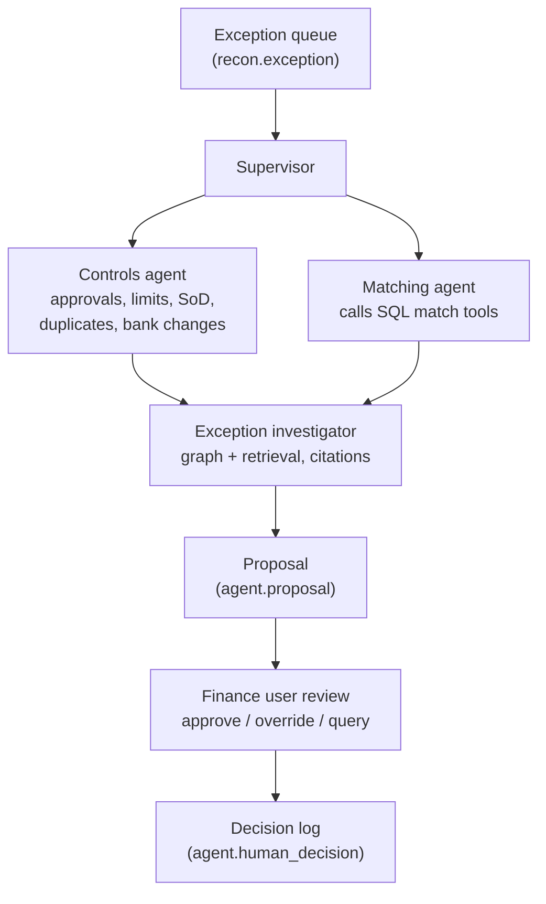

# Agent design

Status: proposed; no agents implemented.

## Principle

Agents investigate and propose. Deterministic SQL computes matches, tolerances and amounts. Finance users decide. Every step is logged and traceable to source rows and cited document chunks.

## Agents

| Agent | Purpose | Tools (read-only) | Output |
| --- | --- | --- | --- |
| Supervisor | Routes each exception, enforces step limits | queue reader | Plan per exception |
| Controls agent | Checks approval presence, approver limit, segregation of duties, split requisitions, retrospective PO, duplicate invoice, recent bank change | SQL control functions, graph approval path | Control findings |
| Matching agent | Runs two- or three-way match and reads variances | SQL match functions | Match findings |
| Exception investigator | Explains the cause and proposes an action with evidence | graph neighbourhood query, hybrid document search, contract lookup | Proposal with citations |

## Tools

- `get_document_chain(invoice_id)` — graph: invoice → PO lines → GRN lines → PR → approvals → supplier golden record.
- `run_match(invoice_id)` — SQL: line-level match result and variances.
- `check_controls(invoice_id)` — SQL: control findings with reason codes.
- `search_documents(query, acting_user)` — hybrid search with permission filter; returns chunk IDs and text.
- `get_contract_terms(supplier_gid, item, date)` — SQL: price and tolerances valid on the document date.

All tools run as the acting user's role so row-level security applies to agents exactly as to people.

## Guardrails

- No tool can post, pay or update `core` or `recon`; agents insert only into `agent`.
- Proposals must cite at least one source row or document chunk; uncited proposals are rejected.
- Auto-approval is not offered for any exception in this case; every proposal needs a human decision.
- Step and token limits per exception; failures fall back to "needs human review".

## Providers

`LLM_PROVIDER` = `offline` (default, deterministic stub for tests and demos), `anthropic` or `ollama`. Embeddings use a small local model by default so no paid API is needed.

## Evaluation

Run all planted scenarios and report: outcome accuracy against expected outcomes, citation validity, false auto-approvals (target zero), latency and token cost per invoice. Retrieval is evaluated separately: recall@k and MRR for vector-only, hybrid, and hybrid plus graph.
