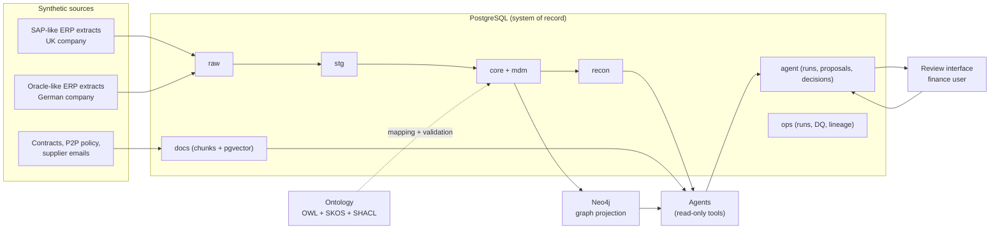

# Architecture

Status: ingestion, core, master data, matching, graph and operations are implemented and run locally. Retrieval, agents, access control and the review interface are design only. Nothing is deployed.

## Context

## Data flow

1. **Ingest:** each source batch lands unchanged in `raw` with `run_id`, `source_system`, `batch_id`, file row and `extracted_at`, checked against its manifest. Batch 2 is a simulated change log. See [decision 0006](decisions/0006-incremental-ingestion.md).
2. **Conform:** `stg` views standardise codes, dates, signs and line numbers; `core` holds the canonical model named after ontology classes. Changed keys come from a watermark with a lookback; unresolved references go to quarantine.
3. **Master data:** `mdm.supplier_golden` and `mdm.supplier_xref` resolve suppliers across ERPs (exact VAT or bank match, then fuzzy name and address score with thresholds: auto-merge, steward review, reject).
4. **Controls and matching:** one SQL function, `recon.run_matching`, writes requisition-level breaches, line-level results and exceptions, GRNI and the proposed accrual to `recon`, as a snapshot per run, using tolerances from the policy and contracts as of the document date.
5. **Graph:** a loader projects `core`, `mdm` and current `recon` into Neo4j using `ontology/mapping.yaml`, and reconciles the counts; the graph is rebuildable at any time.
6. **Retrieval:** documents are chunked, embedded locally and stored in `docs` with access tags; hybrid search (full-text plus vector, fused by rank) and graph neighbourhoods return citations, filtered by the acting user before ranking. See [decision 0007](decisions/0007-retrieval.md).
7. **Agents:** investigate held lines through read-only tools, and write proposals to `agent.proposal` after a guard re-checks them; people accept, override or query them on the review page or the CLI. See [agent design](agent-design.md).
8. **Operations:** every step records status, counts and lineage edges in `ops`; checks and reconciliations go to `ops.dq_result`.

## Boundaries and controls

| Concern | Design |
| --- | --- |
| Source of truth | PostgreSQL. Neo4j and embeddings are derived and rebuildable. |
| Money and matching | SQL only, NUMERIC with currency. The LLM explains and proposes; it never calculates or decides. |
| Agent write access | Enforced by the `agent_service` role: insert into the agent trail only, nothing on `human_decision`, no write anywhere else. |
| Access control | Postgres roles and row-level security on company code, with tools running under the acting person's role. Application filters remain as a second layer. Sign-in is simulated. See [security](security.md). |
| Sensitive data | Bank account numbers are excluded from the graph by the mapping allowlist. No role can read them; a masked view shows the last four characters. They remain in the clear in `raw` and `core` for the pipeline's own login. |
| Audit | Every agent step, tool call, citation and token count is logged. Proposals, citations, human decisions and a trigger-fed audit log are append-only, enforced by triggers. |
| Change control | Versioned [data contracts](../contracts/README.md), and a [CI workflow](../../../.github/workflows/case-06-ci.yml) limited to this case. |
| Offline default | LLM provider `offline` returns deterministic outputs for tests and demos. Live providers are opt-in. |

## Demonstration versus production

The demonstration runs locally in Docker on one machine with small synthetic data. A production design would read from real ERP extraction services (for example SAP CDS views or Oracle BI Cloud Connector), run on a managed platform, use enterprise identity and secrets management, and add monitoring and alerting. None of that is claimed here.

## Decisions

See [decisions](decisions/README.md).
