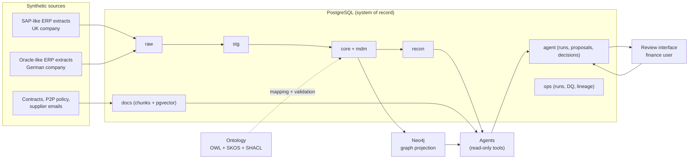

# Architecture

Status: ingestion, core, master data, matching, graph and operations are implemented and run locally. Retrieval, agents, access control and the review interface are design only. Nothing is deployed.

## Context

## Data flow

1. **Ingest:** each source batch lands unchanged in `raw` with `run_id`, `source_system`, `batch_id`, file row and `extracted_at`, checked against its manifest. Batch 2 is a simulated change log. See [decision 0006](decisions/0006-incremental-ingestion.md).
2. **Conform:** `stg` views standardise codes, dates, signs and line numbers; `core` holds the canonical model named after ontology classes. Changed keys come from a watermark with a lookback; unresolved references go to quarantine.
3. **Master data:** `mdm.supplier_golden` and `mdm.supplier_xref` resolve suppliers across ERPs (exact VAT or bank match, then fuzzy name and address score with thresholds: auto-merge, steward review, reject).
4. **Controls and matching:** one SQL function, `recon.run_matching`, writes requisition-level breaches, line-level results and exceptions, GRNI and the proposed accrual to `recon`, as a snapshot per run, using tolerances from the policy and contracts as of the document date.
5. **Graph:** a loader projects `core`, `mdm` and current `recon` into Neo4j using `ontology/mapping.yaml`, and reconciles the counts; the graph is rebuildable at any time.
6. **Retrieval (milestone 2):** documents are chunked, embedded and stored in `docs` with access tags; hybrid search (full-text plus vector) and graph neighbourhoods return citations.
7. **Agents (milestone 2):** investigate exceptions through tools, write proposals to `agent.proposal`; humans approve or override in the review interface.
8. **Operations:** every step records status, counts and lineage edges in `ops`; checks and reconciliations go to `ops.dq_result`.

## Boundaries and controls

| Concern | Design |
| --- | --- |
| Source of truth | PostgreSQL. Neo4j and embeddings are derived and rebuildable. |
| Money and matching | SQL only, NUMERIC with currency. The LLM explains and proposes; it never calculates or decides. |
| Agent write access | Insert into `agent` schema only; no update or delete on `core` or `recon`. |
| Access control (milestone 3) | Postgres roles per company plus controller and auditor; row-level security on company code; agents run on behalf of a user. |
| Sensitive data | Today, bank account numbers are excluded from the graph by the mapping allowlist but unmasked in `core`. Milestone 3: masked in views; full value only for a restricted role. |
| Audit (milestone 2) | Append-only log of agent steps, tool calls, citations and human decisions. |
| Offline default (milestone 2) | LLM provider `offline` returns deterministic outputs for tests and demos. |

## Demonstration versus production

The demonstration runs locally in Docker on one machine with small synthetic data. A production design would read from real ERP extraction services (for example SAP CDS views or Oracle BI Cloud Connector), run on a managed platform, use enterprise identity and secrets management, and add monitoring and alerting. None of that is claimed here.

## Decisions

See [decisions](decisions/README.md).
