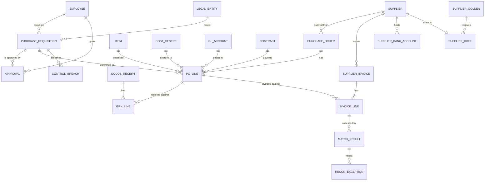

# Data model

Status: implemented for all schemas.

Canonical tables in `core` are named after ontology classes (see [ontology](../ontology/README.md) and [`ontology/mapping.yaml`](../ontology/mapping.yaml)). DDL with grain comments: [`sql/migrations`](../sql/migrations).

## Grain and keys

| Table | Grain | Key | Notes |
| --- | --- | --- | --- |
| raw.* | One row of one delivered file | raw_id | Append-only; all text; run, batch, file, row number, extraction time, CDC operation |
| stg.* | One delivered version of a row (views) | none | Both shapes unified; typing and sign conventions live here |
| core.legal_entity | One company | company_code | GB01 (SAP-like), DE01 (Oracle-like) |
| core.policy_parameter | One parameter in one policy version | (parameter_code, policy_version) | Loaded from the YAML policy; read as of the document date |
| core.fx_rate | One currency pair from one date | (from_currency, to_currency, valid_from) | For approval limits only, never for totalling money |
| core.item | One group item | item_id | Shared master in this synthetic group |
| core.cost_centre, core.gl_account | One code in one company | (company_code, code) | |
| core.supplier | One supplier per source system | (source_system, source_supplier_id) | Primary pay site flattened on |
| core.supplier_bank_account | One account version | (source_system, source_supplier_id, valid_from) | No role can read the number; see core.v_supplier_bank_account_masked. Not projected to the graph |
| core.employee | One limit version of one employee | (source_system, employee_id, valid_from) | Value at the approval date is used |
| core.contract | One version of a price agreement | (contract_id, valid_from) | Tolerance at the invoice date is used |
| core.purchase_requisition | One requisition (single line in both shapes) | (source_system, pr_number) | total_amount = round(quantity × price, 2) |
| core.approval | One approval step | (source_system, pr_number, step) | Oracle SUBMIT rows excluded |
| core.purchase_order | One PO | (source_system, po_number) | |
| core.po_line | One PO line | (source_system, po_number, line_number) | pr_number is here because a PO can consolidate requisitions; match_type from the source flag |
| core.goods_receipt | One receipt document | (source_system, grn_number) | Derived from line-level source rows |
| core.grn_line | One receipt line | (source_system, grn_number, line_number) | Corrections replace the quantity |
| core.supplier_invoice | One invoice or credit note | (source_system, invoice_id) | Credit notes negative whichever way the source delivered them |
| core.invoice_line | One invoice line | (source_system, invoice_id, line_number) | Null PO is valid data |
| mdm.supplier_golden | One real-world supplier | supplier_gid | Rebuilt per run; id stable unless a lower-keyed member joins |
| mdm.supplier_xref | One source supplier | (source_system, source_supplier_id) | Method and score |
| mdm.supplier_match_candidate | One pair merged or for review | both supplier keys | Scores, decision, evidence |
| mdm.steward_decision | One decision on a pair | decision_id | Append-only; latest wins; survives rebuilds |
| recon.match_run | One execution | run_id | Cut-off date |
| recon.control_breach | One requisition × reason × run | (run_id, source_system, pr_number, reason_code) | Evidence as JSON |
| recon.match_result | One invoice line × run | (run_id, source_system, invoice_id, line_number) | Variances, tolerance and its source |
| recon.exception | One invoice line × reason × run | above + reason_code | Reasons are SKOS concepts |
| recon.grni_line | One goods PO line with quantity outstanding × run | (run_id, source_system, po_number, line_number) | PO line because invoices reference PO lines |
| recon.accrual_journal_line | One company × currency × account × side × run | (run_id, company_code, currency_code, gl_account_code, side) | Proposed only; nothing is posted |
| recon.current_* | The latest run of each of the above (views) | as above without run_id | What consumers read |
| recon.current_payment_readiness | One invoice (view) | (source_system, invoice_id) | ReadyForApproval or Held; a person still decides |
| ops.pipeline_run | One CLI step execution | run_id | Written on its own connection, so failures are recorded |
| ops.ingest_file | One file content landed once | (source_system, file_name, checksum) | |
| ops.watermark | One source × entity | (source_system, entity) | High watermark and lookback |
| ops.quarantine | One raw row blocked by a missing parent | quarantine_id, unique (entity, raw_id) | Retried each run |
| ops.dq_result | One check × scope × run | (run_id, check_name, scope) | |
| ops.lineage_edge | One dataset movement × run | (run_id, source_dataset, target_dataset) | Run-level; row-level lineage is core.source_raw_id |
| docs.document | One source document | document_id | `company_code` `GROUP` is visible to all; links to supplier, contract and invoice |
| docs.chunk | One clause, section or policy parameter | chunk_id | Stable id; 384-dimension vector; exact scan by design |
| agent.acting_user | One person agents can act for | user_name | Synthetic; user_name is also their database role |
| agent.run | One execution for one user | agent_run_id | Provider, model and the recon run it read |
| agent.step | One node, or one model call | step_id | Tokens, whether estimated, cost, latency, outcome |
| agent.tool_call | One tool invocation | tool_call_id | Denied calls are recorded |
| agent.proposal | One invoice line × agent run | proposal_id, unique (agent_run_id, source_system, invoice_id, line_number) | Append-only. No column can move money |
| agent.citation | One thing a proposal cites | citation_id | A chunk, or a table and primary key |
| agent.human_decision | One decision on a proposal | decision_id | Append-only; the latest wins; agents have no privilege here |
| agent.review_queue | One line with an open proposal (view) | (source_system, invoice_id, line_number) | Excludes evaluation runs and clean lines |
| agent.audit_log | One audited event | audit_id | Append-only; written only by triggers |
| core.v_supplier_bank_account_masked | One bank account version (view) | (source_system, source_supplier_id, valid_from) | The only route to bank details for any role; last four characters |

## Handling rules

- **Money:** NUMERIC(18,2) for amounts, NUMERIC(18,6) for unit prices, with an ISO currency code. Different currencies are never summed. FX is used only to compare a requisition with an approval limit.
- **Duplicates:** delivered duplicates are absorbed by checksum and upsert if newer. Duplicate supplier invoices are detected on golden supplier, normalised number, currency, amount and date window; the later one is held and consumes no quantity.
- **History:** bank accounts, contracts and approval limits are versioned; the value at the document date is used. Results keep one snapshot per run.
- **Late corrections:** a later row version replaces the core row. Every line is recomputed each run and snapshots show what changed ([decision 0005](decisions/0005-recompute-and-snapshots.md)).
- **Unknown keys:** a missing parent goes to quarantine with a reason, never silently dropped, and the control totals state it as the reconciling item.
- **Deletes:** CDC deletes are soft. Deleted rows leave counts, controls and both projections, and stay in `raw`.
