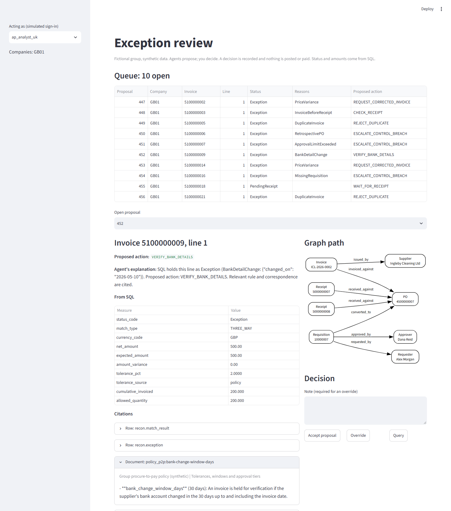

# Five-minute walkthrough

For a reader with a finance background. Everything here is synthetic: the group, its suppliers and its invoices are invented, so the figures show how the system behaves and not what it would save anyone.

## 1. The problem (one minute)

Paying a supplier should rest on evidence that someone asked for the goods, someone with authority approved it, it was ordered at an agreed price, and it arrived. In a group running two ERPs, that evidence sits in two systems with different supplier codes and approval records, and the explanations are in email.

That leaves a controller three exposures:

- **Paying what you should not:** duplicates, overcharges, invoices with nothing behind them, and payments to bank details changed by a fraudster.
- **Weak controls:** approvals over limit, people approving their own requests, and requests split to stay under a limit. The control may exist on paper and still be broken in practice.
- **A wrong month-end:** goods received but not yet invoiced, which should be accrued.

The question this answers: **can software take on the investigation work, while the numbers stay deterministic and finance keeps every decision?**

## 2. How it is built (one minute)

Four ideas, in order of importance:

1. **SQL does the accounting.** Every match, tolerance, control and amount is calculated by rules that give the same answer every time and can be read and tested. Nothing about money comes from a language model.
2. **One model of the business over two ERPs.** Both systems feed one set of definitions, and suppliers are resolved to one real-world record. That is how an invoice sent to both ERPs gets caught, when neither ERP would see it alone.
3. **Agents investigate and propose.** They gather the facts, find the rule that applies and what the supplier wrote, explain the problem and suggest the next step. They cite every source.
4. **People decide.** Clean lines need no review. Everything held goes to a queue, and a failed control can only be cleared by the controller.

In a synthetic population of 360 invoice lines, 338 clear without review and 22 are held, worth GBP 18,965 in the UK company and EUR 34,450 plus GBP 1,000 in the German one.

## 3. One exception, end to end (two minutes)

**The invoice.** Ingleby Cleaning Ltd bills the UK company GBP 500.00 on 20 May (`ICL-2026-0002`). The purchase order, goods receipt and price all agree. A three-way match alone would pass it.

**Why SQL holds it.** The supplier's bank account changed on 10 May, inside the policy's 30-day window. An invoice from the same supplier on 2 May, before the change, is unaffected. The status is `Exception`, reason `BankDetailChange`. This is the textbook pattern for payment-diversion fraud, and no model was involved in catching it.

**What the agents do, for the UK analyst:**

| Step | What happens | Evidence |
| --- | --- | --- |
| Supervisor | Checks the analyst may see this invoice, and reads its status | Match result |
| Controls | Finds the bank-change control has fired | Exception row |
| Matching | Reads the SQL result. It calculates nothing | Match result, no contract |
| Investigator | Follows the graph from invoice to supplier and searches documents | Policy rule on the 30-day window; the UK procedure, which says to telephone the number on file and have it countersigned; the supplier's email |
| Guard | Rechecks the facts and that every citation was really retrieved | Stored proposal |

**What the file shows.** The supplier's email of 9 May asks for new bank details to be used "with immediate effect", and says it cannot take calls and will only reply by email. A good clerk would notice that, because it conflicts directly with the procedure's telephone check.

**The proposal.** `VERIFY_BANK_DETAILS`, with its citations, in the UK analyst's queue. The German analyst cannot see it. The page shows the SQL figures, each citation and the path through the graph, and the analyst accepts, overrides with a reason, or queries it. Nothing is posted or paid either way.

**The audit trail.** [The full trace](../evidence/trace-S14.md) goes from the proposal through each tool call to the cited rows and documents, then through the core rows to the delivered source file, row number and file checksum. An auditor can start from a decision and reach the source.

## 4. The controls (thirty seconds)

| Risk | Control | Tested by |
| --- | --- | --- |
| A model approves a held invoice | A guard allows `AUTO_APPROVE` only if SQL shows the line is clean | A hostile provider tried 13 times and failed. With the guard removed, the same test reports false approvals |
| A supplier's email talks the model round | Documents are marked as untrusted, and the guard ignores what the model believes | Simulated only; **not yet tried against a real model** |
| Someone sees another company's data | Row-level security in the database, applied to agents too | Allowed and denied tests per role, with the application's own filter removed |
| A clerk clears their own control failure | A database policy reserves failed controls for the controller | Tested for each role |
| Bank numbers leak | No role can read them, including the controller and auditor; a masked view shows the last four | Tested for each role |
| History gets rewritten | Triggers refuse changes to proposals, citations, decisions and the audit log | Tested, including for the table owner |
| A data definition changes silently | Versioned contracts for supplier, purchase order, invoice and match result | A breaking change fails the build without a new major version |

## 5. What this does not show (thirty seconds)

- **No live model has been evaluated.** The agents have run on a rule-based stand-in, which shows that the pipeline and controls work. It says nothing about the quality of a model's judgement, and real token costs are unknown.
- **No savings claim.** The data is synthetic and planted, so no fraud was prevented and no time was saved.
- **No finance professional has reviewed the rules.** The definitions are one person's reading of common practice, and the 30-day window and other parameters are illustrative.
- **Not production.** One machine, simulated sign-in, no real ERP connection, no payment system, and the policy has no legal or tax review. Retention periods are proposals.
- **The control mapping is SOX-style, not a SOX programme.**

The next step that would change the picture is a live-model evaluation against the same planted scenarios, because that would measure the one thing this cannot: whether a model's explanations are good enough to save a clerk any time.
